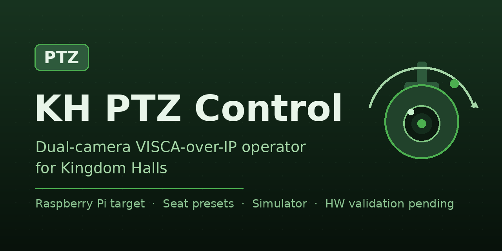
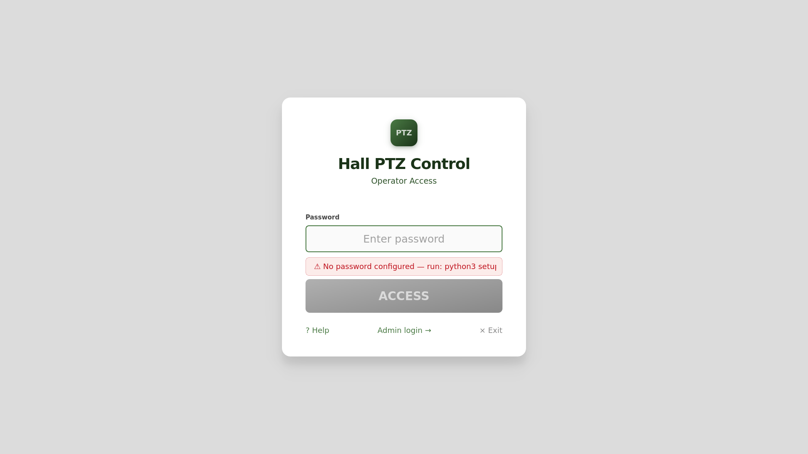
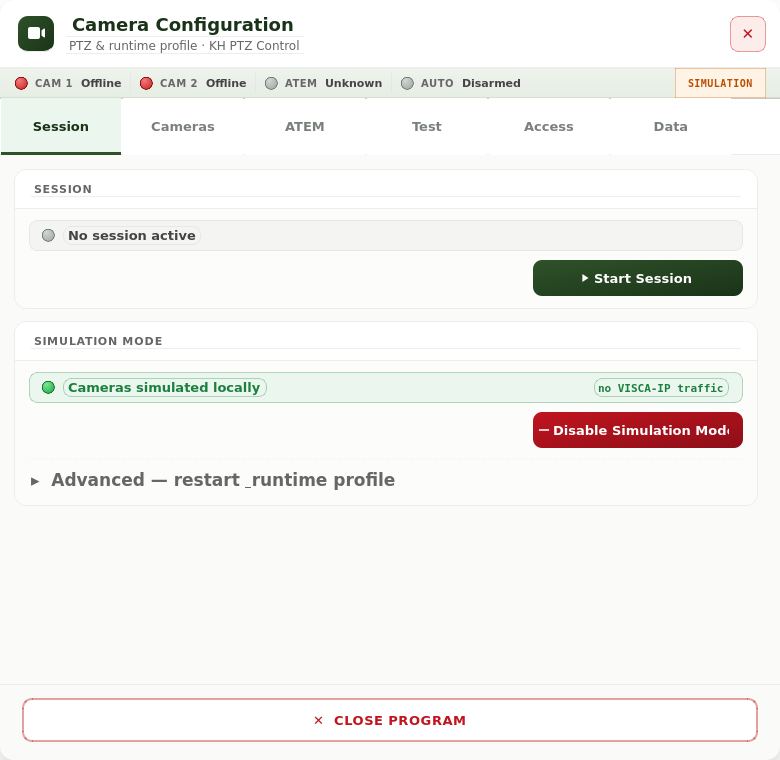
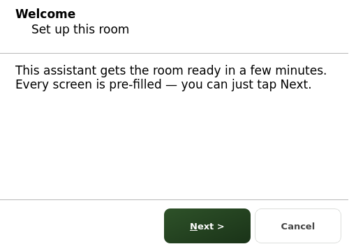
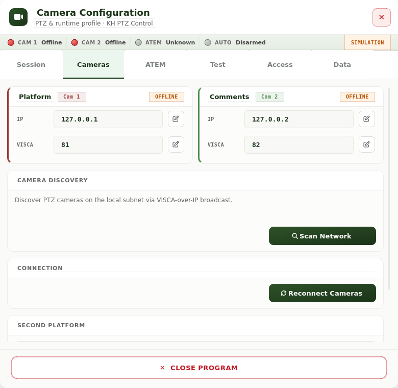
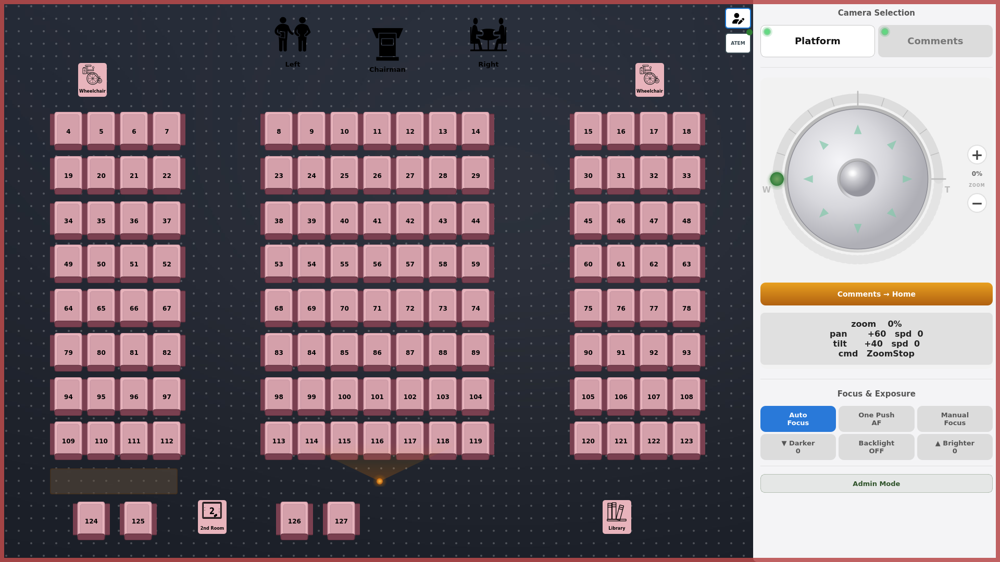
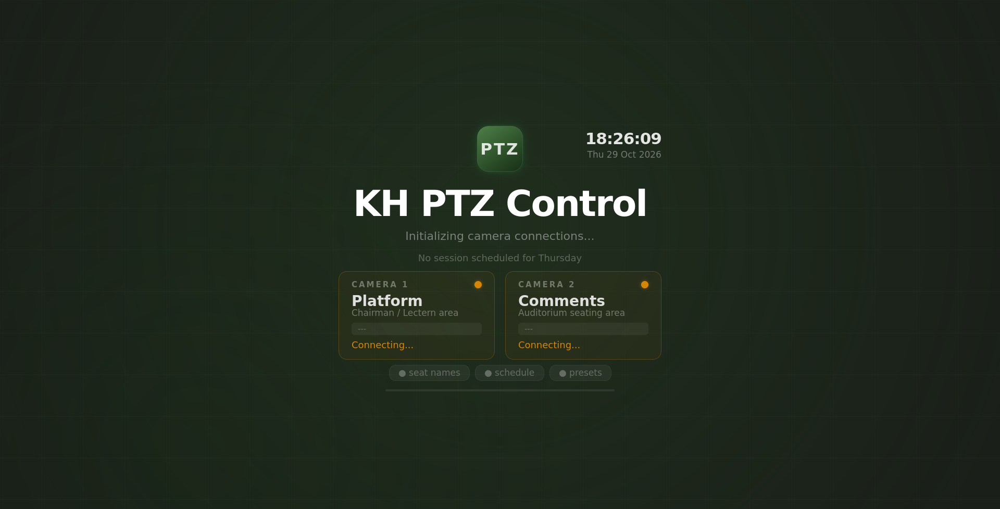
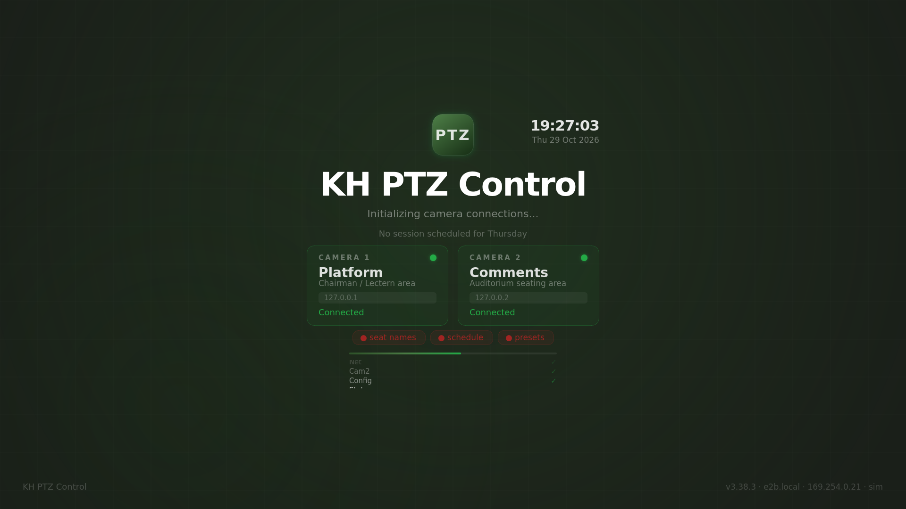

# KH PTZ Control

**English** | [Español](#español)

Touchscreen control of VISCA-over-IP PTZ cameras for Kingdom Halls, running on a
Raspberry Pi. The operator taps a seat on a visual layout of the auditorium and the
cameras frame that person, so friends commenting from the audience can be seen on the
hall's displays and on the video stream during the meeting.

Free and open-source (MIT). Built for a real hall as an installable MVP candidate;
hardware validation is still pending. Any hall may use it freely.



## What it does

- **Visual seat map.** Tap a numbered seat (or a platform position: chairman, lectern,
  reader) and the selected camera moves to the stored preset for that spot.
- **Two cameras.** A "Platform" camera and a "Comments" camera, selected on screen.
- **Presets per seat.** Call mode for live operation; Set mode to store or update the
  framing for any seat in seconds.
- **Session awareness.** The app knows the meeting schedule and arms itself for the
  session; operators just log in and serve.
- **Operator login.** A simple on-screen password protects the controls; an admin role
  unlocks configuration.
- **ATEM integration (optional).** Camera status can follow the video switcher.
- **Simulation mode.** A built-in camera simulator lets you try everything — including
  the full installer and the operator UI — without any camera hardware.


## Safety: STOP is always first

Cameras move; safety is not negotiable. The control path is built so that STOP always
wins:

- A STOP command **queues a pan/tilt stop and a zoom stop together with priority**;
  physical stopping then depends on the camera and the network.
- STOP commands travel in a **priority queue** that bypasses every pending movement.
- If the command queue is full, **new movement commands are dropped — never a STOP**.
- Closing the app or ending a session stops every configured camera.

## Screenshots

| | |
|---|---|
|  |  |
|  |  |
|  |  |
|  | |

## Requirements

- Raspberry Pi 4 or 5 with Raspberry Pi OS **Bookworm (X11 session)** — see
  [docs/INSTALL_RPI.md](docs/INSTALL_RPI.md) for the reference baseline (not yet validated
  on real hardware).
- A touchscreen (the UI is designed for touch) and network access to the cameras.
- One or two VISCA-over-IP PTZ cameras (designed for common AV/PTZ heads; not yet
  validated on real cameras).
- Python 3.11+ with PyQt5 (installed from `apt` on Raspberry Pi OS).

## Install

On a fresh Raspberry Pi OS Bookworm (X11) system:

```bash
git clone https://github.com/HALCONDEORO/kh-ptz-control.git khptz
cd khptz
sudo bash install_khptz_rpi.sh --wizard-user khptz
```

The installer creates the `khptz` service user, installs dependencies, sets up the
systemd service and the autostart session, and finishes with the first-run setup
wizard (camera IPs, seat layout, operator password).

The full guide — prerequisites, validation, backup/restore, rollback and
troubleshooting — is [docs/INSTALL_RPI.md](docs/INSTALL_RPI.md).
New to the project? Start with [docs/FOR_KINGDOM_HALLS.md](docs/FOR_KINGDOM_HALLS.md):
what to buy, the one-command install and how operators use it in the meeting.

### Try it without cameras (simulation mode)

```bash
python3 adapters/sim_mode.py on
```

This points the app at the built-in simulator (no VISCA-IP traffic on your network),
so you can rehearse an installation or a meeting end to end. Turn it off with
`python3 adapters/sim_mode.py off`.



## Status

Working application, installable MVP candidate. Validate it on your own hardware
before relying on it in a live meeting: run `khptz doctor`, rehearse a session in
simulation mode, and record results in `docs/MVP_VALIDATION_REPORT.md`. See
[docs/ROADMAP.md](docs/ROADMAP.md) for what comes next.

## Contributing

Issues and pull requests are welcome. Please read [AGENTS.md](AGENTS.md) and
[docs/DOCS_INDEX.md](docs/DOCS_INDEX.md) first, and keep the layered architecture
boundaries green (`pytest tests/architecture`).

## License

MIT — see [LICENSE](LICENSE).

---

<a id="español"></a>

# KH PTZ Control (ES)

Control por pantalla táctil de cámaras PTZ VISCA-over-IP para Salones del Reino, sobre
una Raspberry Pi. El operador toca un asiento en un plano visual del auditorio y las
cámaras encuadran a esa persona, para que los hermanos que comentan desde el público se
vean en las pantallas del salón y en la transmisión durante la reunión.

Libre y de código abierto (MIT). Construido para un salón real como candidato MVP
instalable; la validación en hardware real aún está pendiente. Cualquier salón puede
usarlo gratis.

## Qué hace

- **Plano visual de asientos.** Toca un asiento numerado (o una posición de plataforma:
  presidente, atril, lector) y la cámara seleccionada va al preset guardado.
- **Dos cámaras.** Una de "Plataforma" y otra de "Comentarios", seleccionables en
  pantalla.
- **Presets por asiento.** Modo Call para operar en directo; modo Set para guardar o
  actualizar el encuadre de cualquier asiento en segundos.
- **Sesiones.** La aplicación conoce el horario de las reuniones y se prepara para cada
  sesión; el operador solo inicia sesión y sirve.
- **Acceso de operador.** Una contraseña en pantalla protege los controles; un rol de
  administrador desbloquea la configuración.
- **Integración ATEM (opcional).** El estado de las cámaras puede seguir al mezclador.
- **Modo simulación.** Un simulador de cámaras integrado permite probarlo todo — incluso
  el instalador completo y la interfaz de operador — sin hardware de cámaras.

## Seguridad: STOP siempre primero

Las cámaras se mueven; la seguridad no es negociable. El camino de control está hecho
para que STOP siempre gane:

- Un comando STOP **encola la parada de pan/tilt y la de zoom juntas, con prioridad**;
  la parada física depende después de la cámara y de la red.
- Los STOP viajan en una **cola prioritaria** que adelanta cualquier movimiento
  pendiente.
- Si la cola está llena, **se descartan los nuevos comandos de movimiento — nunca un
  STOP**.
- Al cerrar la aplicación o terminar una sesión, todas las cámaras configuradas se
  detienen.

## Requisitos

- Raspberry Pi 4 o 5 con Raspberry Pi OS **Bookworm (sesión X11)** — la base de
  referencia (aún no validada en hardware real) está en
  [docs/INSTALL_RPI.md](docs/INSTALL_RPI.md).
- Pantalla táctil (la interfaz está pensada para tacto) y red hacia las cámaras.
- Una o dos cámaras PTZ VISCA-over-IP.
- Python 3.11+ con PyQt5 (instalado desde `apt` en Raspberry Pi OS).

## Instalación

En un sistema Raspberry Pi OS Bookworm (X11) recién instalado:

```bash
git clone https://github.com/HALCONDEORO/kh-ptz-control.git khptz
cd khptz
sudo bash install_khptz_rpi.sh --wizard-user khptz
```

El instalador crea el usuario de servicio `khptz`, instala dependencias, configura el
servicio systemd y el arranque automático, y termina con el asistente de primera
configuración (IPs de cámaras, plano de asientos, contraseña de operador).

La guía completa — requisitos, validación, copia de seguridad/restauración, rollback y
resolución de problemas — está en [docs/INSTALL_RPI.md](docs/INSTALL_RPI.md).

### Probar sin cámaras (modo simulación)

```bash
python3 adapters/sim_mode.py on
```

Apunta la aplicación al simulador integrado (sin tráfico VISCA-IP en tu red) para
ensayar una instalación o una reunión de principio a fin. Se desactiva con
`python3 adapters/sim_mode.py off`.

## Estado

Aplicación funcional, candidata a MVP instalable. Valídala en tu propio hardware antes
de depender de ella en una reunión en directo: ejecuta `khptz doctor`, ensaya una
sesión en modo simulación y registra los resultados en
`docs/MVP_VALIDATION_REPORT.md`.

## Licencia

MIT — ver [LICENSE](LICENSE).
