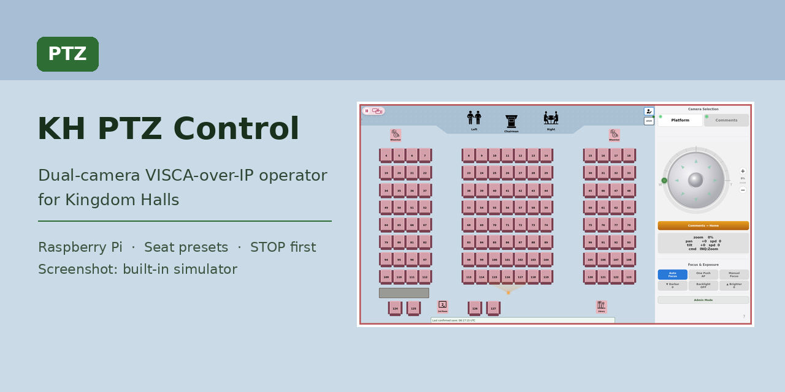
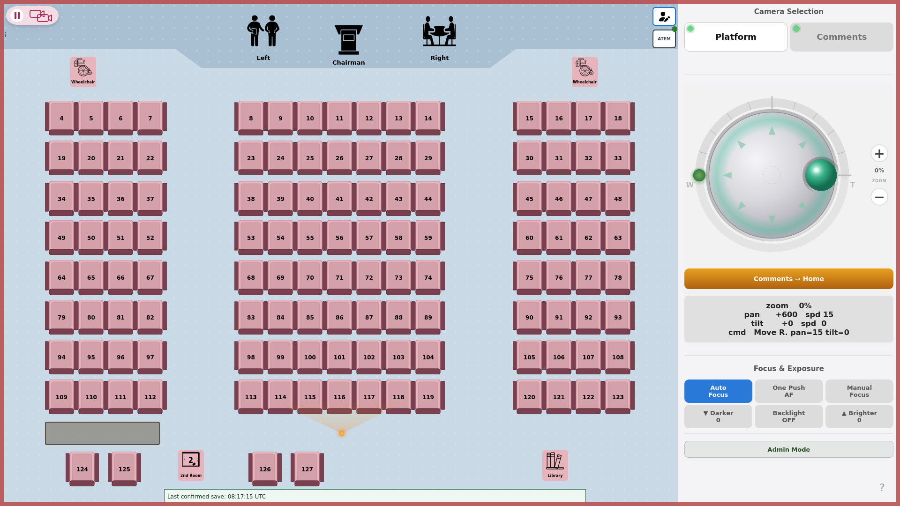
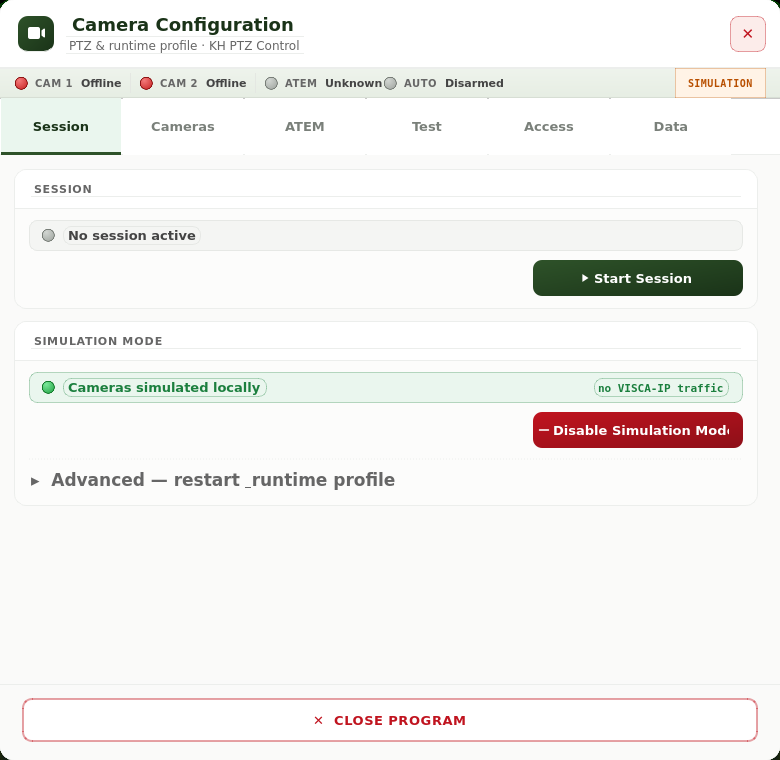

<p align="center">
  <a href="../../README.md">🇬🇧 English</a> ·
  <a href="README.es.md">🇪🇸 Español</a> ·
  <a href="README.pt.md">🇵🇹 Português</a> ·
  <a href="README.fr.md">🇫🇷 Français</a> ·
  <a href="README.de.md">🇩🇪 Deutsch</a> ·
  <a href="README.it.md">🇮🇹 Italiano</a>
</p>

<p align="center">
  
</p>


# KH PTZ Control

[Einseitige Installations-Checkliste](../../QUICKSTART.md) · [Projektseite](https://halcondeoro.github.io/kh-ptz-control/) · [Installation](#installation) · [Bedienungsanleitung](../OPERATOR_GUIDE.md) · [Kamera-Fehlerbehebung](#kamera-fehlerbehebung)

Die Website (auf Englisch) folgt dem Weg Installation, Bedienung und Hilfe. Optionale ATEM- und Architekturdetails stehen eingeklappt hinter der Hilfe. Siehe die [Hinweise zu lokaler Vorschau und Veröffentlichung](../PAGES.md).

Touch-Steuerung für VISCA-over-IP-PTZ-Kameras auf einem Raspberry Pi. Der Bediener tippt auf einen Platz in einem visuellen Saalplan, um dessen gespeicherten Bildausschnitt abzurufen, mit getrennten Rollen für die Platform-Kamera und die Comments-Kamera sowie manuellen Steuerelementen für Joystick, Zoom, Fokus und Belichtung.

Freie Open-Source-Software (MIT). Sie ist auf der Hardware des Maintainers (Raspberry Pi und zwei PTZ-Kameras) installiert und validiert. Die Screenshots in diesem Repository stammen aus dem integrierten Simulator, nicht aus dieser Installation. Automatische Tests und eine erfolgreiche Installation ersetzen nicht die Prüfung beider Kameras, der gespeicherten Bildausschnitte, von STOP und der Wiederaufnahme auf Ihrer eigenen Hardware. Der ursprüngliche Anwendungscode steht unter der MIT-Lizenz. Abhängigkeiten der Oberfläche und optionale Komponenten haben eigene Lizenzen; siehe die [Hinweise zu Drittanbietern](../../THIRD_PARTY_NOTICES.md) und die [ATEM-Abhängigkeitsschranke](../ATEM_DEPENDENCY_DECISION.md), bevor Sie ein installiertes System weitergeben oder ATEM einsetzen.

## Screenshots

Alle Bilder stammen aus dem integrierten Simulator (lokale simulierte Kameras), nicht von einer physischen Installation.

| Bedienoberfläche | Joystick in Bewegung | Einstellungen |
| --- | --- | --- |
|  |  |  |

## Wo anfangen

| Ihre Aufgabe | Zuerst lesen | Prüfen |
| --- | --- | --- |
| Einen Raspberry Pi installieren | [Installationsanleitung](../INSTALL_RPI.md) | Desktop und X11 bereit, Prüfung PASS, Assistent, physische Probe |
| Die Kameras bedienen | [Bedienungsanleitung](../OPERATOR_GUIDE.md) | Kamera und Sitzung gewählt, CALL gegen SET, STOP und physischer Notfallweg |
| Ein Problem eingrenzen | [Fehlerbehebung](#kamera-fehlerbehebung) | Protokolle und Sicherungen aufbewahren; Oberfläche vor eigenständiger Diagnose beenden |
| Den Code verstehen | [Architektur](../ARCHITECTURE.md) | Präsentation, Anwendungsfälle, Domäne, Adapter und Laufzeitgrenzen |

## Was das Projekt kann

- **Visueller Sitzplan.** Tippen Sie auf einen nummerierten Platz (oder eine Position auf dem Podium: Vorsitz, Rednerpult, Leser), und die gewählte Kamera fährt zum gespeicherten Preset dieses Ortes.
- **Zwei Kameras.** Eine „Platform“-Kamera und eine „Comments“-Kamera, am Bildschirm wählbar.
- **Presets pro Platz.** Call-Modus für den Live-Betrieb; Set-Modus, um den Bildausschnitt jedes Platzes in Sekunden zu speichern oder zu aktualisieren.
- **Kamerastrom vom USER-Bildschirm.** Eine kompakte Pause/Play-Taste bietet Standby an, solange eine Sitzung aktiv ist, und sonst das Einschalten, mit demselben Bestätigungsdialog wie beim Start. Standby ist eine Softwareanforderung, keine Netztrennung: Prüfen Sie die physischen Kameras. STOP bleibt eine eigene Aktion.
- **Veränderbares Comments → Home.** Ein Tipp ruft den gespeicherten Home-Ausschnitt ab; fünf Sekunden Halten fragt nach und speichert den aktuellen Comments-Ausschnitt in einem eigenen Preset im Kameraspeicher. Installationen, die nie speichern, behalten das bisherige mechanische Verhalten.
- **Sitzungssteuerung.** Versammlungszeiten und ausdrückliche Sitzungsbefehle trennen den normalen Betrieb von Vorbereitung und Abschluss. Prüfen Sie den Sitzungsstatus am Bildschirm, bevor Sie die Kameras benutzen.
- **Bediener-Anmeldung.** Ein einfaches Passwort am Bildschirm schützt die Steuerung; eine Administratorrolle schaltet die Konfiguration frei.
- **ATEM-Integration (optional).** Der Kamerastatus kann dem Videomischer folgen.
- **Simulationsmodus.** Attrappen oder Demo-Komponenten erlauben das Üben der Oberfläche ohne Kameras; sie validieren keine vollständige Raspberry-Pi-Installation.
- **Veränderbarer Sitzplan (Testvorschau).** Ein nativer Qt-Editor und ein Loopback-Webeditor passen den Plan an Säle mit anderer Anordnung an. Sie starten über einen ausdrücklichen Test-Starter, ohne Aktivierung in der Produktion, ohne LAN-Freigabe und ohne Kamerabefehle; siehe den [Stufenplan](../WEB_LAYOUT_EDITOR_PLAN.md).


## Sicherheit: STOP kommt immer zuerst

Kameras bewegen sich; Sicherheit ist nicht verhandelbar. Der Befehlsweg ist so gebaut, dass STOP immer gewinnt:

- Ein STOP-Befehl **reiht einen Schwenk-/Neige-Stopp und einen Zoom-Stopp gemeinsam und mit Priorität ein**; das physische Anhalten hängt danach von Kamera und Netzwerk ab.
- STOP-Befehle laufen über eine **Prioritätswarteschlange**, die jede wartende Bewegung überholt.
- Ist die Befehlswarteschlange voll, **werden neue Bewegungsbefehle verworfen, niemals ein STOP**.
- Beim Schließen der App oder Beenden einer Sitzung wird der Stopp der konfigurierten Kameras angefordert; prüfen Sie das physische Ergebnis und nutzen Sie den Notfallweg des Ortes, falls das Netzwerk ausfällt.

## Bedienoberfläche

Die Bilder wurden am 25.11.2026 mit der aktuellen Anwendung in einer isolierten lokalen Simulation im USER-Modus erzeugt, mit dem Repository-Hintergrund und simulierten Loopback-Kameras. Sie zeigen die kompakte Kamera-Stromtaste von USER oben links und die Taste Comments → Home. Die Haupttaste STOP ALL ist nur in ADMIN sichtbar. USER kann das dezente `?` unter Admin Mode für die Offline-Anleitungen und STOP BOTH CAMERAS ohne Bestätigung öffnen. Das Anhalten beim Loslassen des Joysticks ist unverändert. Sie enthalten keine Personennamen oder Geräteadressen. Die Kameraanzeigen stammen vom Simulator: Sie zeigen den Simulatorzustand, nicht den des installierten Systems.

## Was dieses Projekt nicht tut

- Kompatibilität mit jedem VISCA-over-IP-Kamera- oder Mischermodell garantieren.
- Physische Bewegung, Speicherung oder Stopp allein aus einer grünen Anzeige oder einem CI-Ergebnis beweisen.
- Den physischen Preset-Speicher der Kamera in einer Sitzplan-Sicherung ablegen.
- Das Proben der Hardware, einen physischen Notfallweg oder die Prüfung der ATEM-Lizenz ersetzen.

## Voraussetzungen

- Raspberry-Pi-Hardware mit Raspberry Pi OS. Zwei Software-Ziele, beide mit zwingender physischer Validierung auf der Zielhardware:
  - **Pi 4 oder 5 / Bookworm (Debian 12) 64 Bit mit Desktop und Python 3.11**: das Installationsziel, im Container geprobt. Bookworm startet standardmäßig mit Wayland und die Oberfläche braucht X11: Wechseln Sie vor der Installation mit `sudo raspi-config` -> Advanced Options -> Wayland -> X11 und starten Sie neu. Verwenden Sie unter Bookworm weder `--atem` noch `--dev` (PEP 668 blockiert dort `pip3`).
  - **Pi 4 / Bullseye (Debian 11) 64 Bit mit Python 3.9.2**: die historische Basis, weiterhin unterstützt. Trixie ist nicht validiert.

  Siehe [docs/INSTALL_RPI.md](../INSTALL_RPI.md) und [docs/RPI_RUNTIME_BASELINE.md](../RPI_RUNTIME_BASELINE.md).
- Ein Touchscreen (die Oberfläche ist für Touch ausgelegt) und Netzwerkzugang zu den Kameras.
- Eine oder zwei VISCA-over-IP-PTZ-Kameras (gedacht für gängige AV/PTZ-Köpfe; noch nicht auf allen Modellen validiert).
- Das System-Python des gewählten Ziels (3.11 unter Bookworm, 3.9.2 unter Bullseye; andere Versionen sind keine unterstützten Ziele) mit PyQt5 (unter Raspberry Pi OS aus `apt` installiert).

## Installation

Auf einem frisch installierten Raspberry Pi OS Bookworm 64 Bit mit Desktop und X11-Sitzung (Bullseye bleibt die historische Basis; siehe [Voraussetzungen](#voraussetzungen)):

### 1. Die geprüfte Version wählen

Führen Sie dies am Desktop des Pi mit Ihrem normalen Benutzer aus. Verwenden Sie das genaue Tag oder den vollständigen Commit-SHA, der für diese Installation freigegeben ist. Das neueste `main` ist keine freigegebene Version.

```bash
git clone https://github.com/HALCONDEORO/kh-ptz-control.git khptz
cd khptz
read -r -p "Approved tag or full commit SHA: " APPROVED_REVISION &&
git checkout --detach "$APPROVED_REVISION" &&
git rev-parse HEAD &&
bash install_khptz_rpi.sh --guide
```

Brechen Sie ab, wenn der Checkout fehlschlägt oder der angezeigte SHA nicht die freigegebene Version ist. Lesen Sie die Anleitung, bevor Sie weitermachen.

### 2. Die Bereitschaft prüfen

Lassen Sie dasselbe Terminal offen. `--wizard-user` ist Ihr vorhandener Desktop-Benutzer, nicht das vom Installer angelegte Dienstkonto.

```bash
sudo bash install_khptz_rpi.sh --wizard-user "$USER" --check
```

Schlägt die Prüfung fehl, brechen Sie ab und folgen Sie dem genannten Schritt. Grüne CI ist keine physische Validierung des Pi.

### 3. Erst nach PASS installieren

```bash
sudo bash install_khptz_rpi.sh --wizard-user "$USER"
```

Ausgabe 20 heißt, dass noch Konfiguration fehlt; 30 heißt, anhalten und den Fehler untersuchen. Bewahren Sie die Installer-Ausgabe auf und fügen Sie nie Passwörter in Berichte ein.

### 4. Die Konfiguration abschließen

Der Installer legt den Dienstbenutzer `khptz`, die Abhängigkeiten, den systemd-Dienst und die Autostart-Sitzung an. Folgen Sie seiner Ausgabe: Starten Sie neu und melden Sie sich am Desktop an, oder führen Sie dort `khptz setup` aus. Der Assistent erfragt Saaldaten, Kameraadressen und Anmeldeeinstellungen. Folgen Sie den Hinweisen; verwenden Sie kein Standardpasswort.

Die vollständige Anleitung (Voraussetzungen, Validierung, Sicherung/Wiederherstellung, Rückbau und Fehlerbehebung) ist [docs/INSTALL_RPI.md](../INSTALL_RPI.md). Wenn das Projekt neu für Sie ist, folgen Sie der [Installations-Checkliste](../INSTALL_TODAY_ES.md) (auf Spanisch) für Hardwareprüfung, Installation und Übergabe.

### Ohne Kameras ausprobieren

Starten Sie aus einer Wegwerf-Kopie des Codes die neue **Adapterprobe nur auf der Konsole**:

```bash
python3 -m simulation.rehearsal
python3 -m simulation.rehearsal --json
```

Sie nutzt die FakeCamera-Adapter im Speicher für Platform und Comments, ohne PyQt, Kameraadressen, Passwörter oder Produktionskonfiguration. Sie verweigert Socket-Operationen im eigenen Prozess und übt Speichern/Abrufen, Stopp und Standby. Es ist nicht die vollständige Bedienoberfläche und beweist weder physische Bewegung, noch die Zustellung von STOP über das Netzwerk, Hardware-Latenz, Kamerakompatibilität oder eine Pi-Installation. Siehe die [einseitige Checkliste und ihre Grenzen](../../QUICKSTART.md).

Das ältere Werkzeug `adapters/sim_mode.py on` schreibt die lokale Kamerakonfiguration um; das ist ein anderer Mechanismus. Verwenden Sie es nicht auf einer laufenden Installation.

## Kamerabedienung und Presets

1. Prüfen Sie die gewählte Kamera und den Sitzungsstatus, bevor Sie eine Position abrufen. Halten Sie je Kamera nur einen steuernden Prozess verbunden. Eine zweite App, ein Simulator, ein Erkennungswerkzeug oder eine Netzwerksonde kann bei Kameramodellen mit einer einzigen Sitzung eine dauerhafte VISCA-Verbindung verdrängen.
2. Verwenden Sie **CALL**, um einen Ausschnitt abzurufen. Verwenden Sie **SET** nur, wenn Sie die gespeicherte Position der Kamera überschreiben wollen, mit dem nötigen Zugang und der Bestätigung. Testen Sie jede gespeicherte Position außerhalb einer Live-Versammlung, mit jemandem, der das physische Ergebnis beobachtet. Siehe [CALL/SET](../CALL_SET_CONTRACT.md).
3. Behandeln Sie eine grüne Verbindungsanzeige als Transportinformation. Dass ein Befehl in die Warteschlange gelangt, bestätigt keine physische Bewegung. Eine Zeitüberschreitung oder ein fehlgeschlagenes Speichern ist kein Erfolg; drücken Sie nicht wiederholt SET, damit sich die Anzeige ändert.
4. Proben Sie im ADMIN-Modus vor dem Live-Einsatz die rote Taste **STOP ALL** unter den Kamerasteuerungen und den Schließoptionen. Der USER-Modus blendet sie aus; die Offline-Hilfe (`?` unter Admin Mode) bietet STOP BOTH CAMERAS ohne Bestätigung. Das Öffnen der Hilfe sendet keinen Befehl. Beide Wege versuchen anzuhalten, ohne den physischen Stopp zu bestätigen; das Loslassen des Joysticks fordert weiterhin den Stopp der bewegten Kamera an, nicht aller. Halten Sie den physischen Notfallweg ohne Administratorzugang bereit. STOP ALL fordert den Stopp der konfigurierten Kameras auch ohne aktive Sitzung an; eine Fehlermeldung heißt, dass sich eine Kamera noch bewegen kann. Prüfen Sie das physische Ergebnis. Safety Reset ist ein Dienstvertrag, kein geprüfter Oberflächenbefehl. Lesen Sie die [Sicherheitsgarantien und -grenzen](../OPERATOR_GUIDE.md). Nutzen Sie den physischen Notfallweg des Ortes, statt anzunehmen, dass das Software-STOP angekommen ist.

VISCA-Presets liegen im Kameraspeicher. `chairman_presets.json` ordnet Namen persönlichen Preset-Plätzen zu; `room_layout.json` speichert den Sitzplan. Eine Sicherung dieser Dateien kopiert nicht den Preset-Speicher der physischen Kamera. Fehlt eine Tabelle oder ist sie beschädigt, bewahren Sie das Datenverzeichnis und die Sicherungen auf, bevor Sie neue Positionen speichern: Das Wiederverwenden eines Platzes kann den früheren Ausschnitt einer Person überschreiben.

## Optionale ATEM-Integration

ATEM ist optional. Operative Tasten, Panels und Zustände bleiben verborgen, bis der konfigurierte Mischer verbunden und eine gültige Programmauslesung bestätigt ist. Die Administrator-Einstellungen behalten IP-Konfiguration und Diagnose, damit ein nicht erreichbarer Mischer konfiguriert werden kann. Fehlende ATEM-Unterstützung muss die PTZ-Steuerung verfügbar lassen.

Manuelles Schalten und Automatisierung haben eigene Rollen- und Sicherheitsregeln. Lassen Sie das automatische Schalten deaktiviert, bis seine Sicherheitsprüfung bestanden ist. PyATEMMax 1.0b9 ist eine eingefrorene technische Vorabversion unter GPL-Lizenz, weder eine Freigabe zur Verteilung noch eine Garantie für Hardwarekompatibilität. Lesen Sie vor jedem Einsatz die [Abhängigkeitsentscheidung und Release-Schranken](../ATEM_DEPENDENCY_DECISION.md), die [Hinweise zu Drittanbietern](../../THIRD_PARTY_NOTICES.md) und die [ATEM-Installationsanleitung](../ATEM_INSTALLATION.md).

## Aktualisieren und Zurückrollen

Tun Sie dies außerhalb einer Live-Sitzung, mit einer aktuellen Sicherung und einem freigegebenen Tag oder vollständigen SHA. Behalten Sie die ursprüngliche Code-Kopie: `/opt/khptz` ist eine ausgerollte Kopie, kein Ort für `git pull`.

1. Notieren Sie `khptz version` und `khptz status`. Führen Sie `khptz backup` aus, prüfen Sie den Erfolg und bewahren Sie die ZIP-Datei außerhalb des Geräts auf, bevor Sie etwas ändern. Sicherungen können private Ortsdaten enthalten; hängen Sie sie nicht an öffentliche Tickets.
2. Schließen Sie die Oberfläche sauber. Beenden Sie die installierte Oberflächen-Unit: den Systemdienst oder den Dienst des Desktop-Benutzers, je nach Installationsmodus. Starten Sie nicht beide.
3. Holen Sie in der Code-Kopie die freigegebene Version und wählen Sie sie aus, dann verwenden Sie das [Installationsskript](../INSTALL_RPI.md#install-the-runtime-service). Behalten Sie den Desktop-Benutzer und den Oberflächenmodus bei. Aktualisieren Sie kein laufendes System mit ungeprüftem `main` und reparieren Sie Berechtigungen nicht mit rekursivem `chmod`/`chown`.
4. Führen Sie vor dem Öffnen der Oberfläche `khptz verify-install` aus. Mit beendeter Oberfläche führen Sie `khptz doctor` aus und prüfen das Ergebnis. Proben Sie danach CALL, STOP und die Wiederaufnahme an beiden Kameras. Eine Softwareprüfung bescheinigt keinen physischen Betrieb.

Für eine Produktinstallation sehen Sie sich zuerst das gespeicherte Rückbauziel an:

```bash
sudo bash /opt/khptz/runtime/installer/rollback.sh --dry-run
```

Erst nachdem Ziel, Sicherung und Stillstandsfenster geprüft sind:

```bash
sudo bash /opt/khptz/runtime/installer/rollback.sh
```

Der Rückbau rollt den Code aus der aufbewahrten Code-Kopie neu aus. Das ist nicht dasselbe wie das Einspielen einer Datensicherung. Verwenden Sie [Update and rollback](../UPDATE_ROLLBACK.md) für ausdrückliche `--source`-/`--to`-Ziele und Details zum Oberflächenmodus. Stellen Sie keinen alten Plan wieder her und setzen Sie den Assistenten nicht zurück, nur um ein Code-Update rückgängig zu machen.

## Kamera-Fehlerbehebung

Gehen Sie vom Symptom aus, nicht von einem Werksreset. Bewahren Sie den Versions-SHA, den Zeitpunkt des Ausfalls und einen kurzen Protokollauszug auf. Entfernen Sie Ortsadressen, Namen und Zugangsdaten, bevor Sie etwas öffentlich teilen.

| Symptom | Prüfungen und nächster Schritt |
|---|---|
| Kamera 1 oder 2 wechselt zwischen verbunden und getrennt | Suchen Sie nach einer weiteren Oberfläche oder einem anderen Controller und prüfen Sie den konfigurierten Endpunkt. Beenden Sie die Sitzung sicher, bevor Sie neue Netzwerksonden öffnen. Prüfen Sie Kabel, Switch-Port, Kameraversorgung und ob die Kamera nur einen TCP-Client zulässt. Ein grünes Abzeichen allein beweist nicht, dass ein Befehl abgeschlossen ist. |
| `Connection refused`, leere Antwort oder ACK ohne Abschluss | Abgelehnt heißt, die Verbindung wurde zurückgewiesen, nicht dass die verlangte Bewegung beendet ist. Prüfen Sie Endpunkt, Lauschen der Kamera und konkurrierende Controller. Bewahren Sie Bytes und Zeitstempel auf; schleifen Sie keine Wiederverbindungen und verlängern Sie Zeitlimits nicht blind. |
| Ein weißes Sitzraster oder verschwindende Steuerelemente nach einem Tipp auf einen Platz | Bewahren Sie die Protokolle auf und notieren Sie Kamera, Sitzungsstatus, CALL/SET-Modus und Aktion. Suchen Sie nach einer Python-Ausnahmespur und einer gleichzeitigen Zustandsänderung der Kamera. Löschen Sie den Plan nicht, überschreiben Sie keine Presets und starten Sie Repair nicht auf Verdacht. |
| Oberfläche fehlt oder ist dunkel nach der Desktop-Anmeldung | Prüfen Sie, welcher Oberflächendienst das Fenster besitzt und ob die Desktop-Sitzung X11 ist. Siehe die [Checkliste zum dunklen Bildschirm](../INSTALL_RPI.md#the-gui-never-appears-after-login-dark-screen). Starten Sie keine zweite Oberfläche, um eine fehlgeschlagene zu verdecken. |
| Adress- oder Preset-Änderungen verschwinden nach dem Neustart | Prüfen Sie, ob die Oberfläche einen Speicherfehler gemeldet hat. Bewahren Sie `config.yaml`, jede Kameraeinstellung zur Laufzeit und die Sicherungen der Preset-Tabelle auf. Machen Sie `/etc/khptz` nicht beschreibbar, um einen fehlgeschlagenen Speichervorgang zu umgehen. |

Eine Antwort aus der Praxis kann ein ACK über direktes IP gefolgt von einem adressierten Abschluss enthalten, etwa `9041ff` + `a051ff` oder `9042ff` + `a052ff`. Bewahren Sie die vollständige Bytefolge auf, nicht nur das ACK. Diese Beispiele bedeuten nicht, dass beliebige zwei Frames einen Erfolg beweisen: Adresse, Befehls-Socket, Abschlussfehler und überschrittenes Zeitlimit zählen ebenfalls. Siehe [camera command results](../CAMERA_COMMAND_RESULTS.md).

`khptz verify-install` prüft den Installationszustand ohne Hardwarezugriff. Führen Sie dagegen `khptz cameras` und `khptz doctor` nicht neben einer laufenden Oberfläche aus: Diese eigenständigen Diagnosen können zusätzliche Verbindungen zu den Kameras öffnen. Beenden Sie zuerst die Oberfläche und planen Sie ein sicheres Testfenster. Ein Support-Paket wird bereinigt, aber prüfen Sie es vor dem Teilen; siehe den [Umfang des Support-Pakets](../SUPPORT_BUNDLE_CONTRACT.md).

Für Installationen, bei denen die Oberfläche ein Systemdienst ist:

```bash
khptz version
khptz status
sudo systemctl status khptz-control.service --no-pager
journalctl -u khptz-control.service -n 100 --no-pager
```

Für eine sitzungseigene Oberfläche führen Sie dies mit deren Desktop-Benutzer aus:

```bash
systemctl --user status khptz-gui.service --no-pager
journalctl --user -u khptz-gui.service -n 100 --no-pager
```

Veröffentlichen Sie keine rohen Protokolle, ohne zu prüfen, dass sie keine privaten Informationen enthalten. Für die längere Liste beginnen Sie mit der [Installations-Fehlerbehebung](../INSTALL_RPI.md).

## Repository-Übersicht

Halten Sie den Anwendungscode getrennt von Konfiguration und gespeicherten Ortsdaten:

| Pfad | Zuständigkeit |
|---|---|
| `main.py`, `bootstrap.py` | Einstiegspunkt und Verdrahtung der Abhängigkeiten |
| `domain/`, `application/` | Modelle, Validierung und Anwendungsfälle |
| `ports/`, `adapters/` | Schnittstellen und ihre Hardware- und Speicher-Implementierungen |
| `ptz/visca/` | VISCA-Frames, Parsing, Worker und Besitz der Verbindung |
| `core/` | Ereignisbehandlung, Laufzeitzustand und Überwachung |
| `ui/` | PyQt-Fenster, Steuerelemente und Plan-Darstellung |
| `runtime/`, `install_khptz_rpi.sh` | CLI, Bereitstellung, systemd und Installationsprüfungen |
| `config/` | Konfigurationsschema und mitgelieferte Vorlagen, keine echten Ortsdaten |
| `simulation/`, `tests/` | Simulierte Hardware und Regressionstests |
| `docs/` | Anleitungen für Betrieb, Installation, Support und Entwicklung |

Produktinstallationen halten die Konfiguration in `/etc/khptz`, Laufzeitdaten in `/var/lib/khptz`, Protokolle in `/var/log/khptz` und Sicherungen in `/var/backups/khptz`. Verschieben Sie sie nicht in die Code-Kopie. Siehe den [Dokumentationsindex](../DOCS_INDEX.md), die [Architektur](../ARCHITECTURE.md) und den [Vertrag der Laufzeitpfade](../RUNTIME_PATH_CONTRACT.md), bevor Sie Code umorganisieren.

## Status

Vom Maintainer installiert und validiert; die Entwicklung geht weiter. Beenden Sie die Oberfläche vor jeder eigenständigen Kameradiagnose; starten Sie keinen zweiten Controller gegen laufende Kameras. Proben Sie sicher, validieren Sie die physische Hardware und halten Sie die Ergebnisse in `docs/MVP_VALIDATION_REPORT.md` fest. Simulation ist keine physische Validierung. Siehe [docs/ROADMAP.md](../ROADMAP.md) für das weitere Vorgehen.

## Mitwirken

Tickets und Pull Requests sind willkommen. Lesen Sie zuerst [AGENTS.md](../../AGENTS.md) und [docs/DOCS_INDEX.md](../DOCS_INDEX.md) und halten Sie die Grenzen der Schichtenarchitektur (`pytest tests/architecture`) grün.

## Lizenz

Ursprünglicher Code: MIT, siehe [LICENSE](../../LICENSE). Installierte Abhängigkeiten behalten ihre eigenen Bedingungen; siehe [THIRD_PARTY_NOTICES.md](../../THIRD_PARTY_NOTICES.md).
