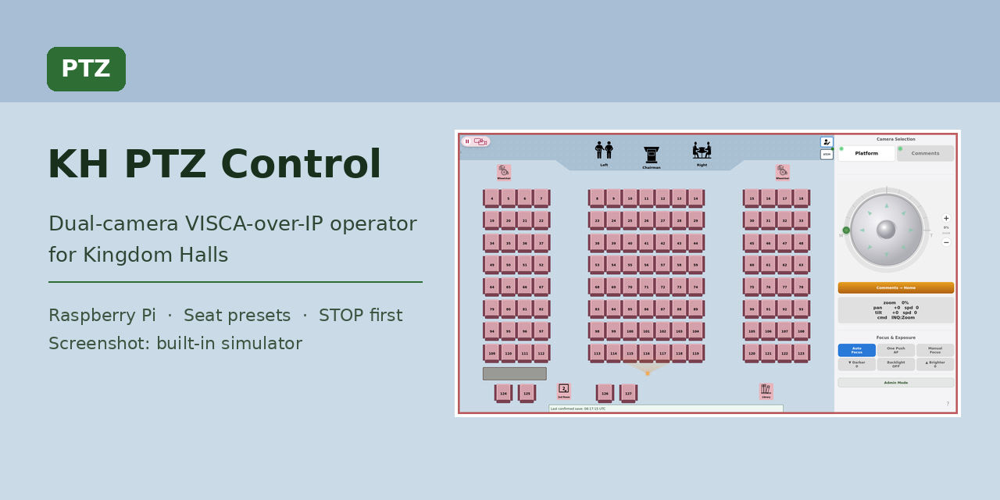
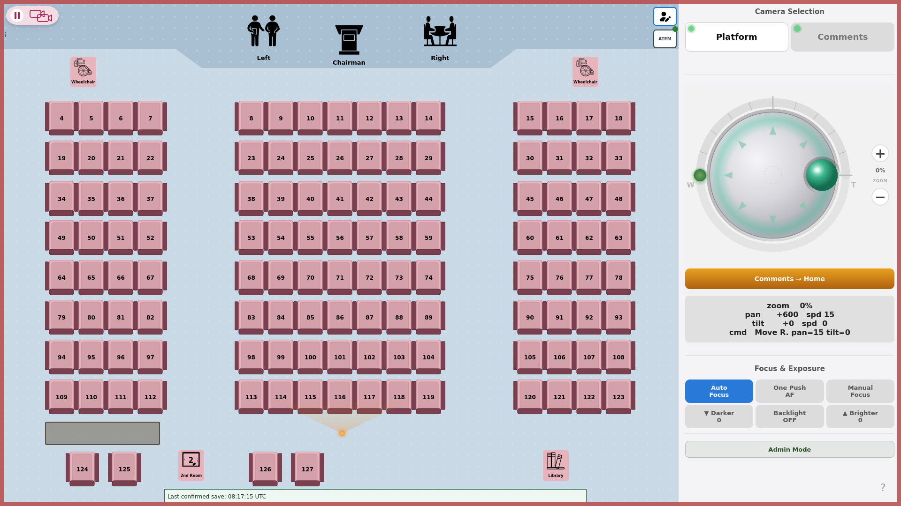
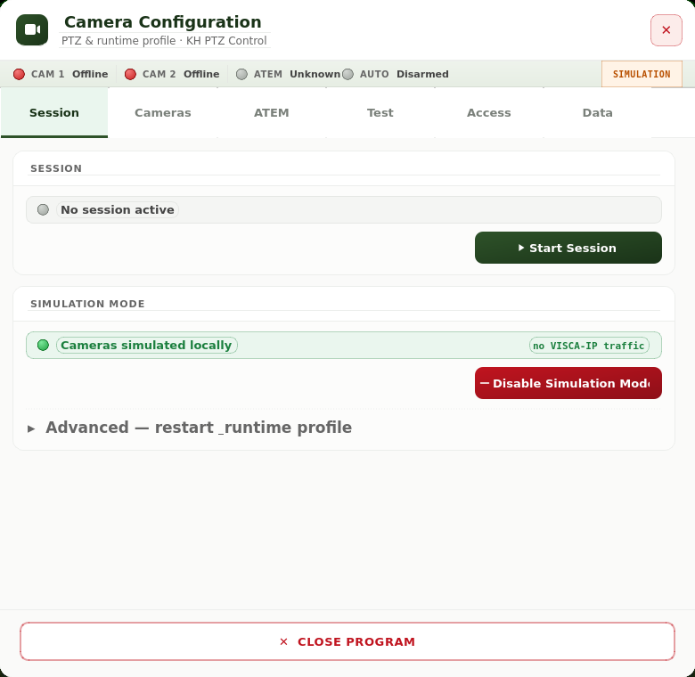

<p align="center">
  <a href="../../README.md">🇬🇧 English</a> ·
  <a href="README.es.md">🇪🇸 Español</a> ·
  <a href="README.pt.md">🇵🇹 Português</a> ·
  <a href="README.fr.md">🇫🇷 Français</a> ·
  <a href="README.de.md">🇩🇪 Deutsch</a> ·
  <a href="README.it.md">🇮🇹 Italiano</a>
</p>

<p align="center">
  
</p>


# KH PTZ Control

[Lista de instalación de una página](../../QUICKSTART.md) · [Sitio web del proyecto](https://halcondeoro.github.io/kh-ptz-control/) · [Instalación](#instalación) · [Guía del operador](../OPERATOR_GUIDE.md) · [Solución de problemas](#solución-de-problemas-de-las-cámaras)

El sitio web (en inglés) sigue el camino de instalación, uso y ayuda. Los detalles opcionales de ATEM y de arquitectura van plegados después de la ayuda. Consulta las [notas de vista previa local y publicación](../PAGES.md).

Control táctil de cámaras PTZ VISCA-over-IP en una Raspberry Pi. El operador toca un asiento en un plano visual del auditorio para recuperar su encuadre guardado, con funciones separadas para la cámara Platform y la cámara Comments, y controles manuales de joystick, zoom, enfoque y exposición.

Libre y de código abierto (MIT). Está instalado y validado en el equipo del propio mantenedor (Raspberry Pi y dos cámaras PTZ). Las capturas de este repositorio proceden del simulador integrado, no de esa instalación. Las pruebas automáticas y una instalación correcta no sustituyen la validación de ambas cámaras, de los encuadres guardados, de STOP y de la recuperación en tu propio equipo. El código original de la aplicación tiene licencia MIT. Las dependencias de la interfaz y los componentes opcionales tienen licencias propias; consulta los [avisos de terceros](../../THIRD_PARTY_NOTICES.md) y la [puerta de dependencia de ATEM](../ATEM_DEPENDENCY_DECISION.md) antes de compartir un sistema instalado o de desplegar ATEM.

## Capturas

Todas las imágenes proceden del simulador integrado (cámaras locales simuladas), no de una instalación física.

| Pantalla del operador | Joystick en movimiento | Ajustes |
| --- | --- | --- |
|  |  |  |

## Empieza aquí

| Tu tarea | Lee primero | Qué comprobar |
| --- | --- | --- |
| Instalar una Raspberry Pi | [Guía de instalación](../INSTALL_RPI.md) | Escritorio y X11 listos, comprobación PASS, asistente, ensayo físico |
| Manejar las cámaras | [Guía del operador](../OPERATOR_GUIDE.md) | Cámara y sesión seleccionadas, CALL frente a SET, STOP y alternativa física |
| Diagnosticar un problema | [Solución de problemas](#solución-de-problemas-de-las-cámaras) | Conserva registros y copias; para la GUI antes de diagnósticos independientes |
| Entender el código | [Arquitectura](../ARCHITECTURE.md) | Presentación, casos de uso, dominio, adaptadores y límites de ejecución |

## Qué hace

- **Plano visual de asientos.** Toca un asiento numerado (o una posición de la plataforma: presidente, atril, lector) y la cámara seleccionada va al preset guardado para ese lugar.
- **Dos cámaras.** Una cámara "Platform" y una cámara "Comments", que se eligen en pantalla.
- **Presets por asiento.** Modo Call para operar en directo; modo Set para guardar o actualizar el encuadre de cualquier asiento en segundos.
- **Encendido de cámaras desde la pantalla USER.** Un botón compacto de pausa/play ofrece standby mientras hay una sesión activa y encendido cuando no la hay, con el mismo diálogo de confirmación que el inicio. Standby es una petición por software, no un corte de corriente: confirma las cámaras físicas. STOP sigue siendo una acción aparte.
- **Comments → Home editable.** Un toque recupera el encuadre Home guardado; mantener el botón cinco segundos pide confirmación y guarda el encuadre actual de Comments en un preset propio en la memoria de la cámara. Las instalaciones que nunca guardan uno mantienen el comportamiento mecánico anterior.
- **Control de sesión.** Los horarios de reunión y los controles explícitos de sesión separan la operación normal de la preparación y el cierre. Revisa el estado de sesión en pantalla antes de usar las cámaras.
- **Inicio de sesión del operador.** Una contraseña sencilla en pantalla protege los controles; un rol de administrador desbloquea la configuración.
- **Integración ATEM (opcional).** El estado de las cámaras puede seguir al mezclador de vídeo.
- **Modo simulación.** Componentes falsos o de demostración permiten ensayar la interfaz sin cámaras; no validan una instalación completa en Raspberry Pi.
- **Plano de asientos editable (vista previa de pruebas).** Un editor nativo Qt y un editor web en loopback adaptan el plano a salas con otra distribución. Se ejecutan desde un lanzador de pruebas explícito, sin activación en producción, sin exposición a la red local y sin comandos a las cámaras; consulta el [plan por etapas](../WEB_LAYOUT_EDITOR_PLAN.md).


## Seguridad: STOP siempre primero

Las cámaras se mueven; la seguridad no es negociable. La ruta de control está diseñada para que STOP siempre gane:

- Un comando STOP **encola una parada de giro/inclinación y una parada de zoom juntas con prioridad**; que la cámara se detenga físicamente depende de la cámara y de la red.
- Los comandos STOP viajan por una **cola de prioridad** que se salta todo movimiento pendiente.
- Si la cola de comandos está llena, **se descartan los comandos de movimiento nuevos, nunca un STOP**.
- Cerrar la aplicación o terminar una sesión pide una parada de las cámaras configuradas; confirma el resultado físico y usa la alternativa del lugar si falla la red.

## Pantalla del operador

Las capturas se generaron con la aplicación actual en una simulación local aislada en modo USER el 25/11/2026, con el fondo del repositorio y cámaras simuladas en loopback. Muestran el botón compacto de encendido de cámaras de USER arriba a la izquierda y el botón Comments → Home. El botón principal STOP ALL solo es visible en ADMIN. USER puede abrir el discreto `?` bajo Admin Mode para guías sin conexión y STOP BOTH CAMERAS, sin confirmación. La parada al soltar el joystick no cambia. No contienen nombres personales ni direcciones de dispositivos. Los indicadores de cámara vienen del simulador, así que muestran el estado del simulador, no el del sistema instalado.

## Lo que este proyecto no hace

- Garantizar compatibilidad con todos los modelos de cámara o mezclador VISCA-over-IP.
- Demostrar movimiento, guardado o parada física a partir de un indicador verde o de un resultado de CI.
- Guardar la memoria física de presets de la cámara dentro de una copia del plano de asientos.
- Sustituir el ensayo del equipo, una alternativa física o la revisión de la licencia de ATEM.

## Requisitos

- Hardware Raspberry Pi con Raspberry Pi OS. Dos objetivos de software, ambos con validación física obligatoria en el equipo de destino:
  - **Pi 4 o 5 / Bookworm (Debian 12) de 64 bits con Escritorio y Python 3.11**: el objetivo de instalación, ensayado en contenedor. Bookworm arranca en Wayland por defecto y la interfaz necesita X11: cambia la sesión con `sudo raspi-config` -> Advanced Options -> Wayland -> X11 y reinicia antes de instalar. No uses `--atem` ni `--dev` en Bookworm (PEP 668 bloquea `pip3`).
  - **Pi 4 / Bullseye (Debian 11) de 64 bits con Python 3.9.2**: la base heredada, aún compatible. Trixie no está validado.

  Consulta [docs/INSTALL_RPI.md](../INSTALL_RPI.md) y [docs/RPI_RUNTIME_BASELINE.md](../RPI_RUNTIME_BASELINE.md).
- Una pantalla táctil (la interfaz está pensada para tacto) y acceso de red a las cámaras.
- Una o dos cámaras PTZ VISCA-over-IP (pensado para cabezales AV/PTZ habituales; aún no validado en todos los modelos).
- El Python del sistema del objetivo elegido (3.11 en Bookworm, 3.9.2 en Bullseye; otras versiones no son objetivos admitidos) con PyQt5 (instalado desde `apt` en Raspberry Pi OS).

## Instalación

En un sistema Raspberry Pi OS Bookworm de 64 bits con Escritorio y sesión X11 recién instalado (Bullseye sigue como base heredada; consulta [Requisitos](#requisitos)):

### 1. Elige la versión revisada

Ejecuta desde el escritorio de la Pi con tu usuario normal. Usa la etiqueta exacta o el SHA completo del commit aprobado para esta instalación. La última `main` no es una versión aprobada.

```bash
git clone https://github.com/HALCONDEORO/kh-ptz-control.git khptz
cd khptz
read -r -p "Approved tag or full commit SHA: " APPROVED_REVISION &&
git checkout --detach "$APPROVED_REVISION" &&
git rev-parse HEAD &&
bash install_khptz_rpi.sh --guide
```

Para si el checkout falla o el SHA mostrado no es la versión aprobada. Lee la guía antes de continuar.

### 2. Comprueba la preparación

Mantén abierta la misma terminal. `--wizard-user` indica tu usuario de escritorio existente, no la cuenta de servicio que crea el instalador.

```bash
sudo bash install_khptz_rpi.sh --wizard-user "$USER" --check
```

Si la comprobación falla, para y sigue su siguiente paso. Que pase la CI no es validación física de la Pi.

### 3. Instala solo tras PASS

```bash
sudo bash install_khptz_rpi.sh --wizard-user "$USER"
```

La salida 20 significa que aún falta configuración; la 30, que debes parar e inspeccionar el fallo. Guarda la salida del instalador y nunca pegues contraseñas en informes.

### 4. Completa la configuración

El instalador crea el usuario de servicio `khptz`, las dependencias, el servicio systemd y la sesión de inicio automático. Sigue su salida: reinicia e inicia sesión en el escritorio, o ejecuta allí `khptz setup`. El asistente recoge los datos de la sala, las direcciones de las cámaras y los ajustes de acceso. Sigue las indicaciones; no uses una contraseña predeterminada.

La guía completa (requisitos previos, validación, copia y restauración, vuelta atrás y solución de problemas) es [docs/INSTALL_RPI.md](../INSTALL_RPI.md). Si eres nuevo en el proyecto, sigue la [lista de instalación](../INSTALL_TODAY_ES.md) para la revisión del equipo, la instalación y la entrega.

### Probar sin cámaras

Desde una copia de código desechable, ejecuta el nuevo **ensayo de adaptadores solo por consola**:

```bash
python3 -m simulation.rehearsal
python3 -m simulation.rehearsal --json
```

Usa los adaptadores FakeCamera en memoria para Platform y Comments, sin PyQt, direcciones de cámara, contraseñas ni configuración de producción. Deniega las operaciones de socket en su proceso y ejercita guardar/recuperar, stop y standby. No es la GUI completa del operador y no demuestra movimiento físico, entrega de STOP por red, latencia del hardware, compatibilidad de cámaras ni una instalación en Pi. Consulta la [lista de una página y sus límites](../../QUICKSTART.md).

El antiguo ayudante `adapters/sim_mode.py on` reescribe la configuración local de cámaras; es un mecanismo distinto. No lo uses en una instalación que funciona.

## Manejo de cámaras y presets

1. Comprueba la cámara seleccionada y el estado de la sesión antes de recuperar una posición. Mantén un solo proceso controlador conectado a cada cámara. Una segunda aplicación, simulador, herramienta de descubrimiento o sonda de red puede desplazar una conexión VISCA persistente en modelos de cámara de una sola sesión.
2. Usa **CALL** para recuperar un encuadre. Usa **SET** solo cuando quieras sobrescribir la posición guardada de la cámara, con el acceso y la confirmación necesarios. Prueba cada posición guardada fuera de una reunión en directo, con alguien mirando el resultado físico. Consulta [CALL/SET](../CALL_SET_CONTRACT.md).
3. Trata un indicador verde de conexión como información de transporte. Que el comando entre en la cola no confirma el movimiento físico. Un tiempo agotado o un guardado fallido no es un éxito; no pulses SET repetidamente para que cambie el indicador.
4. En modo ADMIN, ensaya el botón rojo **STOP ALL** bajo los controles de cámara y las opciones de cierre antes del uso en directo. El modo USER oculta este botón; la ayuda sin conexión (`?` bajo Admin Mode) ofrece STOP BOTH CAMERAS sin confirmación. Abrir la ayuda no envía comandos. Ambas rutas intentan parar, no confirman la parada física; soltar el joystick sigue pidiendo parada de la cámara movida, no de todas. Mantén disponible la alternativa física sin acceso de administrador. STOP ALL pide parada de las cámaras configuradas incluso sin sesión activa; un aviso de fallo significa que una cámara aún podría moverse. Confirma el resultado físico. Safety Reset es un contrato de servicio, no un control de la GUI verificado. Lee las [garantías y límites de seguridad](../OPERATOR_GUIDE.md). Usa la alternativa física del lugar en vez de suponer que el STOP por software llegó.

Los presets VISCA se guardan en la memoria de la cámara. `chairman_presets.json` asigna nombres a ranuras de preset personales; `room_layout.json` guarda el plano de asientos. Una copia de estos ficheros no copia la memoria de presets de la cámara física. Si falta un mapa o está dañado, conserva el directorio de datos y las copias antes de guardar posiciones nuevas: reutilizar una ranura puede sobrescribir el encuadre previo de una persona.

## Integración ATEM opcional

ATEM es opcional. Los botones, paneles y estados operativos permanecen ocultos hasta que el mezclador configurado está conectado y se ha verificado una lectura de programa válida. Los ajustes de administrador conservan la configuración de IP y los diagnósticos para poder configurar un mezclador no disponible. Si falta soporte de ATEM, el control PTZ debe seguir disponible.

La conmutación manual y la automática tienen sus propias reglas de rol y seguridad. Mantén desactivada la conmutación automática hasta que pase su revisión de seguridad. PyATEMMax 1.0b9 es una base técnica preliminar fijada, con términos de licencia GPL, no una aprobación de distribución ni una garantía de compatibilidad de hardware. Revisa la [decisión de dependencia y las puertas de versión](../ATEM_DEPENDENCY_DECISION.md), los [avisos de terceros](../../THIRD_PARTY_NOTICES.md) y la [guía de instalación de ATEM](../ATEM_INSTALLATION.md) antes de desplegar.

## Actualización y vuelta atrás

Hazlo fuera de una sesión en directo, con una copia de seguridad reciente y una etiqueta aprobada o un SHA completo. Conserva la copia de código original: `/opt/khptz` es una copia desplegada, no el lugar para ejecutar `git pull`.

1. Anota `khptz version` y `khptz status`. Ejecuta `khptz backup`, comprueba que terminó bien y guarda el ZIP resultante fuera del dispositivo antes de cambiarlo. Las copias pueden contener datos privados del lugar; no las adjuntes a incidencias públicas.
2. Cierra la GUI limpiamente. Para la unidad GUI instalada: el servicio del sistema o el del usuario de escritorio, según el modo de instalación. No arranques ambas.
3. En la copia de código, descarga y selecciona la versión aprobada y usa el [script de instalación](../INSTALL_RPI.md#install-the-runtime-service). Conserva el usuario de escritorio y el modo de la GUI. No actualices un sistema en uso con una `main` sin revisar ni repares permisos con `chmod`/`chown` recursivos.
4. Antes de reabrir la GUI, ejecuta `khptz verify-install`. Con la GUI parada, ejecuta `khptz doctor` e inspecciona el resultado. Después ensaya CALL, STOP y la recuperación en ambas cámaras. Una comprobación por software no certifica el funcionamiento físico.

En una instalación de producto, previsualiza primero el destino de vuelta atrás registrado:

```bash
sudo bash /opt/khptz/runtime/installer/rollback.sh --dry-run
```

Solo después de comprobar el destino, la copia y la ventana de parada:

```bash
sudo bash /opt/khptz/runtime/installer/rollback.sh
```

La vuelta atrás vuelve a desplegar el código desde la copia de código conservada. No es lo mismo que restaurar una copia de datos. Usa [Update and rollback](../UPDATE_ROLLBACK.md) para destinos explícitos `--source` / `--to` y detalles del modo de GUI. No restaures un plano antiguo ni reinicies el asistente solo para deshacer una actualización de código.

## Solución de problemas de las cámaras

Empieza por el síntoma, no por un restablecimiento de fábrica. Conserva el SHA de la versión, la hora del fallo y un extracto breve del registro. Borra direcciones del lugar, nombres y credenciales antes de compartir nada públicamente.

| Síntoma | Comprobaciones y siguiente paso |
|---|---|
| La cámara 1 o 2 alterna entre conectada y desconectada | Comprueba si hay otra GUI o controlador y verifica el endpoint configurado. Para la sesión con seguridad antes de abrir nuevas sondas de red. Revisa cable, puerto del switch, alimentación de la cámara y si la cámara admite un solo cliente TCP. Una insignia verde por sí sola no prueba que un comando terminó. |
| `Connection refused`, respuesta vacía o ACK sin finalización | Rechazada significa que se rechazó la conexión, no que el movimiento pedido terminó. Revisa el endpoint, el servicio de la cámara y controladores que compitan. Conserva los bytes y las marcas de tiempo; no repitas reconexiones ni subas tiempos de espera a ciegas. |
| Una cuadrícula blanca de asientos o controles que desaparecen al tocar un asiento | Conserva los registros y anota cámara, estado de sesión, modo CALL/SET y acción. Busca un traceback de Python y un cambio simultáneo del estado de la cámara. No borres el plano, no sobrescribas presets ni ejecutes Repair a ciegas. |
| GUI ausente u oscura tras iniciar sesión en el escritorio | Comprueba qué servicio GUI posee la ventana y si la sesión del escritorio es X11. Consulta la [lista de pantalla oscura](../INSTALL_RPI.md#the-gui-never-appears-after-login-dark-screen). No arranques una segunda GUI para tapar una que falló. |
| Los cambios de dirección o de presets desaparecen tras reiniciar | Comprueba si la interfaz avisó de un fallo al guardar. Conserva `config.yaml`, cualquier ajuste de cámara en ejecución y las copias del mapa de presets. No hagas `/etc/khptz` escribible para saltarte un guardado fallido. |

Una respuesta de campo puede traer un ACK de IP directa seguido de una finalización dirigida, por ejemplo `9041ff` + `a051ff`, o `9042ff` + `a052ff`. Conserva la secuencia completa de bytes, no solo el ACK. Estos ejemplos no son una regla de que dos tramas cualesquiera prueben el éxito: la dirección, el socket de comandos, el error final y el tiempo agotado también cuentan. Consulta [camera command results](../CAMERA_COMMAND_RESULTS.md).

`khptz verify-install` comprueba el estado de la instalación sin acceder al hardware. En cambio, no ejecutes `khptz cameras` ni `khptz doctor` junto a una GUI en uso: estos diagnósticos independientes pueden abrir conexiones adicionales a las cámaras. Para la GUI primero y organiza una ventana de prueba segura. Un paquete de soporte está depurado, pero revísalo antes de compartirlo; consulta el [alcance del paquete de soporte](../SUPPORT_BUNDLE_CONTRACT.md).

Para instalaciones con la GUI como servicio del sistema:

```bash
khptz version
khptz status
sudo systemctl status khptz-control.service --no-pager
journalctl -u khptz-control.service -n 100 --no-pager
```

Para una GUI propia de la sesión, ejecuta esto como su usuario de escritorio:

```bash
systemctl --user status khptz-gui.service --no-pager
journalctl --user -u khptz-gui.service -n 100 --no-pager
```

No publiques registros sin revisar si contienen información privada. Para la lista más larga, empieza en la [solución de problemas de instalación](../INSTALL_RPI.md).

## Mapa del repositorio

Mantén el código de la aplicación separado de la configuración y de los datos del lugar:

| Ruta | Responsabilidad |
|---|---|
| `main.py`, `bootstrap.py` | Punto de entrada y cableado de dependencias |
| `domain/`, `application/` | Modelos, validación y casos de uso |
| `ports/`, `adapters/` | Interfaces y sus implementaciones de hardware y almacenamiento |
| `ptz/visca/` | Tramas, análisis, workers y propiedad de la conexión VISCA |
| `core/` | Gestión de eventos, estado de ejecución y supervisión |
| `ui/` | Ventanas PyQt, controles y dibujo del plano |
| `runtime/`, `install_khptz_rpi.sh` | CLI, despliegue, systemd y comprobaciones de instalación |
| `config/` | Esquema de configuración y plantillas incluidas, no datos reales del lugar |
| `simulation/`, `tests/` | Equipo simulado y pruebas de regresión |
| `docs/` | Guías de operador, instalación, soporte y desarrollo |

Las instalaciones de producto guardan la configuración en `/etc/khptz`, los datos de ejecución en `/var/lib/khptz`, los registros en `/var/log/khptz` y las copias en `/var/backups/khptz`. No los muevas a la copia de código. Consulta el [índice de documentación](../DOCS_INDEX.md), la [arquitectura](../ARCHITECTURE.md) y el [contrato de rutas de ejecución](../RUNTIME_PATH_CONTRACT.md) antes de reorganizar código.

## Estado

Instalado y validado por el mantenedor; el desarrollo continúa. Para la GUI antes de diagnósticos de cámara independientes; no ejecutes un segundo controlador contra cámaras en uso. Ensaya con seguridad, valida el equipo físico y anota los resultados en `docs/MVP_VALIDATION_REPORT.md`. La simulación no es validación física. Consulta [docs/ROADMAP.md](../ROADMAP.md) para lo que viene.

## Contribuir

Las incidencias y los pull requests son bienvenidos. Lee primero [AGENTS.md](../../AGENTS.md) y [docs/DOCS_INDEX.md](../DOCS_INDEX.md), y mantén en verde los límites de la arquitectura por capas (`pytest tests/architecture`).

## Licencia

Código original: MIT, consulta [LICENSE](../../LICENSE). Las dependencias instaladas mantienen sus propios términos; consulta [THIRD_PARTY_NOTICES.md](../../THIRD_PARTY_NOTICES.md).
