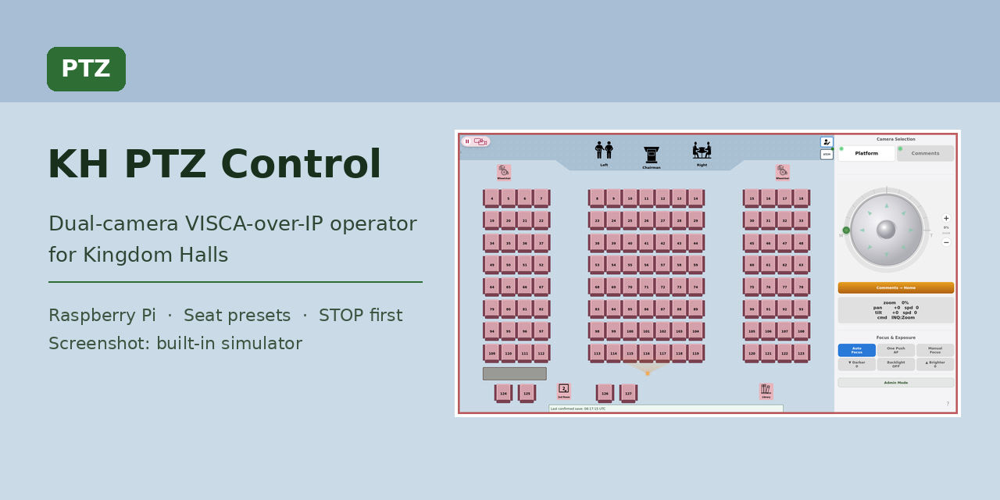
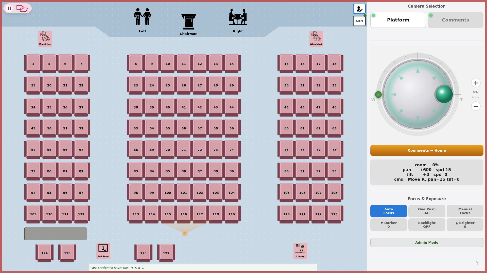
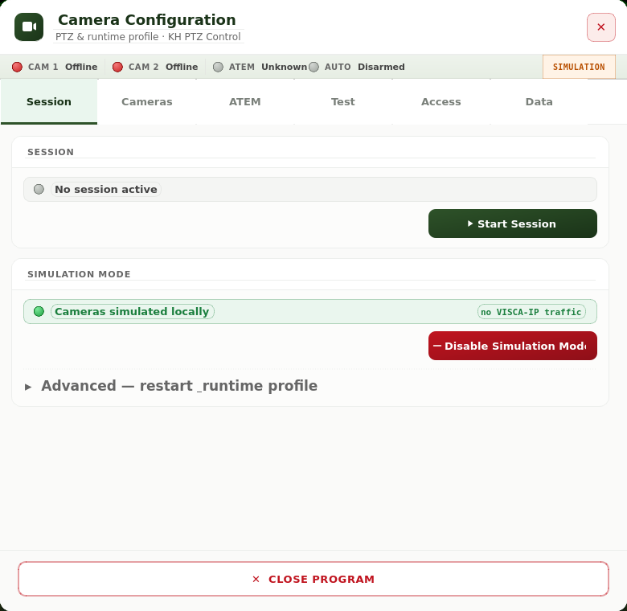

<p align="center">
  <a href="../../README.md">🇬🇧 English</a> ·
  <a href="README.es.md">🇪🇸 Español</a> ·
  <a href="README.pt.md">🇵🇹 Português</a> ·
  <a href="README.fr.md">🇫🇷 Français</a> ·
  <a href="README.de.md">🇩🇪 Deutsch</a> ·
  <a href="README.it.md">🇮🇹 Italiano</a>
</p>

<p align="center">
  
</p>


# KH PTZ Control

[Liste d’installation d’une page](../../QUICKSTART.md) · [Site du projet](https://halcondeoro.github.io/kh-ptz-control/) · [Installation](#installation) · [Guide de l’opérateur](../OPERATOR_GUIDE.md) · [Dépannage](#dépannage-des-caméras)

Le site (en anglais) suit le parcours installation, utilisation et aide. Les détails facultatifs sur ATEM et l’architecture sont repliés après l’aide. Voir les [notes d’aperçu local et de publication](../PAGES.md).

Pilotage tactile de caméras PTZ VISCA-over-IP sur un Raspberry Pi. L’opérateur touche une place sur un plan visuel de la salle pour rappeler son cadrage enregistré, avec des rôles distincts pour la caméra Platform et la caméra Comments, et des commandes manuelles de joystick, zoom, mise au point et exposition.

Libre et open source (MIT). Il est installé et validé sur le matériel du mainteneur (Raspberry Pi et deux caméras PTZ). Les captures de ce dépôt proviennent du simulateur intégré, pas de cette installation. Les tests automatiques et une installation réussie ne remplacent pas la validation des deux caméras, des cadrages enregistrés, de STOP et de la reprise sur votre propre matériel. Le code d’origine de l’application est sous licence MIT. Les dépendances de l’interface et les composants facultatifs ont leurs propres licences ; voir les [avis tiers](../../THIRD_PARTY_NOTICES.md) et la [barrière de dépendance ATEM](../ATEM_DEPENDENCY_DECISION.md) avant de partager un système installé ou de déployer ATEM.

## Captures d’écran

Toutes les images proviennent du simulateur intégré (caméras locales simulées), pas d’une installation physique.

| Écran de l’opérateur | Joystick en mouvement | Réglages |
| --- | --- | --- |
|  |  |  |

## Par où commencer

| Votre tâche | À lire d’abord | À vérifier |
| --- | --- | --- |
| Installer un Raspberry Pi | [Guide d’installation](../INSTALL_RPI.md) | Bureau et X11 prêts, contrôle PASS, assistant, répétition physique |
| Utiliser les caméras | [Guide de l’opérateur](../OPERATOR_GUIDE.md) | Caméra et session sélectionnées, CALL contre SET, STOP et solution physique de secours |
| Diagnostiquer un problème | [Dépannage](#dépannage-des-caméras) | Conservez journaux et sauvegardes ; arrêtez l’interface avant tout diagnostic autonome |
| Comprendre le code | [Architecture](../ARCHITECTURE.md) | Présentation, cas d’usage, domaine, adaptateurs et limites d’exécution |

## Ce que fait le projet

- **Plan visuel des places.** Touchez une place numérotée (ou une position de l’estrade : président, pupitre, lecteur) et la caméra sélectionnée va au preset enregistré pour cet endroit.
- **Deux caméras.** Une caméra « Platform » et une caméra « Comments », choisies à l’écran.
- **Presets par place.** Mode Call pour l’exploitation en direct ; mode Set pour enregistrer ou mettre à jour le cadrage de n’importe quelle place en quelques secondes.
- **Alimentation des caméras depuis l’écran USER.** Un bouton compact pause/lecture propose la veille tant qu’une session est active et l’allumage sinon, avec la même boîte de confirmation qu’au démarrage. La veille est une demande logicielle, pas une coupure secteur : vérifiez les caméras physiques. STOP reste une action distincte.
- **Comments → Home modifiable.** Un appui rappelle le cadrage Home enregistré ; maintenir le bouton cinq secondes demande confirmation et enregistre le cadrage actuel de Comments dans un preset dédié de la mémoire de la caméra. Les installations qui n’en enregistrent jamais gardent l’ancien comportement mécanique.
- **Contrôle de session.** Les horaires de réunion et les commandes de session explicites séparent l’exploitation normale de la préparation et de l’arrêt. Vérifiez l’état de session à l’écran avant d’utiliser les caméras.
- **Connexion de l’opérateur.** Un mot de passe simple à l’écran protège les commandes ; un rôle administrateur déverrouille la configuration.
- **Intégration ATEM (facultative).** L’état des caméras peut suivre le mélangeur vidéo.
- **Mode simulation.** Des composants factices ou de démonstration permettent de répéter l’interface sans caméras ; ils ne valident pas une installation complète sur Raspberry Pi.
- **Plan des places modifiable (aperçu de test).** Un éditeur Qt natif et un éditeur web en loopback adaptent le plan à des salles d’une autre disposition. Ils se lancent depuis un lanceur de test explicite, sans activation en production, sans exposition au réseau local et sans commande aux caméras ; voir le [plan par étapes](../WEB_LAYOUT_EDITOR_PLAN.md).


## Sécurité : STOP passe toujours en premier

Les caméras bougent ; la sécurité n’est pas négociable. Le chemin de commande est conçu pour que STOP l’emporte toujours :

- Une commande STOP **met en file un arrêt panoramique/inclinaison et un arrêt de zoom ensemble, avec priorité** ; l’arrêt physique dépend ensuite de la caméra et du réseau.
- Les commandes STOP passent par une **file prioritaire** qui double tout mouvement en attente.
- Si la file de commandes est pleine, **les nouvelles commandes de mouvement sont abandonnées, jamais un STOP**.
- Fermer l’application ou terminer une session demande l’arrêt des caméras configurées ; vérifiez le résultat physique et utilisez la solution de secours du lieu si le réseau tombe.

## Écran de l’opérateur

Les captures ont été générées avec l’application actuelle dans une simulation locale isolée en mode USER le 25/11/2026, avec le fond du dépôt et des caméras simulées en loopback. Elles montrent le bouton compact d’alimentation des caméras de USER en haut à gauche et le bouton Comments → Home. Le bouton principal STOP ALL n’est visible qu’en ADMIN. USER peut ouvrir le discret `?` sous Admin Mode pour les guides hors ligne et STOP BOTH CAMERAS, sans confirmation. L’arrêt au relâchement du joystick ne change pas. Elles ne contiennent ni noms de personnes ni adresses d’appareils. Les indicateurs des caméras viennent du simulateur : ils montrent l’état du simulateur, pas celui du système installé.

## Ce que ce projet ne fait pas

- Garantir la compatibilité avec tous les modèles de caméra ou de mélangeur VISCA-over-IP.
- Prouver un mouvement, un enregistrement ou un arrêt physique à partir d’un voyant vert ou d’un résultat de CI.
- Stocker la mémoire physique de presets de la caméra dans une sauvegarde du plan des places.
- Remplacer la répétition du matériel, une solution physique de secours ou l’examen de la licence ATEM.

## Prérequis

- Matériel Raspberry Pi avec Raspberry Pi OS. Deux cibles logicielles, toutes deux avec validation physique obligatoire sur le matériel visé :
  - **Pi 4 ou 5 / Bookworm (Debian 12) 64 bits avec bureau et Python 3.11** : la cible d’installation, répétée en conteneur. Bookworm démarre en Wayland par défaut et l’interface exige X11 : changez de session avec `sudo raspi-config` -> Advanced Options -> Wayland -> X11 puis redémarrez avant d’installer. N’utilisez pas `--atem` ni `--dev` sous Bookworm (la PEP 668 y bloque `pip3`).
  - **Pi 4 / Bullseye (Debian 11) 64 bits avec Python 3.9.2** : la base historique, toujours prise en charge. Trixie n’est pas validé.

  Voir [docs/INSTALL_RPI.md](../INSTALL_RPI.md) et [docs/RPI_RUNTIME_BASELINE.md](../RPI_RUNTIME_BASELINE.md).
- Un écran tactile (l’interface est conçue pour le tactile) et un accès réseau aux caméras.
- Une ou deux caméras PTZ VISCA-over-IP (prévu pour les têtes AV/PTZ courantes ; pas encore validé sur tous les modèles).
- Le Python système de la cible choisie (3.11 sous Bookworm, 3.9.2 sous Bullseye ; les autres versions ne sont pas des cibles prises en charge) avec PyQt5 (installé depuis `apt` sur Raspberry Pi OS).

## Installation

Sur un système Raspberry Pi OS Bookworm 64 bits avec bureau et session X11 fraîchement installé (Bullseye reste la base historique ; voir [Prérequis](#prérequis)) :

### 1. Choisir la version relue

Exécutez depuis le bureau du Pi avec votre utilisateur normal. Utilisez l’étiquette exacte ou le SHA complet du commit approuvé pour cette installation. La dernière `main` n’est pas une version approuvée.

```bash
git clone https://github.com/HALCONDEORO/kh-ptz-control.git khptz
cd khptz
read -r -p "Approved tag or full commit SHA: " APPROVED_REVISION &&
git checkout --detach "$APPROVED_REVISION" &&
git rev-parse HEAD &&
bash install_khptz_rpi.sh --guide
```

Arrêtez-vous si le checkout échoue ou si le SHA affiché n’est pas la version approuvée. Lisez le guide avant de continuer.

### 2. Vérifier la préparation

Gardez le même terminal ouvert. `--wizard-user` désigne votre utilisateur de bureau existant, pas le compte de service créé par l’installeur.

```bash
sudo bash install_khptz_rpi.sh --wizard-user "$USER" --check
```

Si le contrôle échoue, arrêtez-vous et suivez l’étape indiquée. Une CI au vert n’est pas une validation physique du Pi.

### 3. N’installer qu’après PASS

```bash
sudo bash install_khptz_rpi.sh --wizard-user "$USER"
```

La sortie 20 signifie qu’il manque encore de la configuration ; la 30, qu’il faut s’arrêter et examiner l’échec. Conservez la sortie de l’installeur et ne collez jamais de mots de passe dans des rapports.

### 4. Terminer la configuration

L’installeur crée l’utilisateur de service `khptz`, les dépendances, le service systemd et la session de démarrage automatique. Suivez sa sortie : redémarrez et ouvrez une session sur le bureau, ou lancez-y `khptz setup`. L’assistant recueille les informations de la salle, les adresses des caméras et les réglages de connexion. Suivez les instructions ; n’utilisez pas de mot de passe par défaut.

Le guide complet (prérequis, validation, sauvegarde/restauration, retour arrière et dépannage) est [docs/INSTALL_RPI.md](../INSTALL_RPI.md). Si le projet est nouveau pour vous, suivez la [liste d’installation](../INSTALL_TODAY_ES.md) (en espagnol) pour le contrôle du matériel, l’installation et la remise.

### Essayer sans caméras

Depuis une copie de code jetable, lancez la nouvelle **répétition d’adaptateurs en console seule** :

```bash
python3 -m simulation.rehearsal
python3 -m simulation.rehearsal --json
```

Elle utilise les adaptateurs FakeCamera en mémoire pour Platform et Comments, sans PyQt, adresses de caméra, mots de passe ni configuration de production. Elle refuse les opérations de socket dans son processus et exerce enregistrement/rappel, stop et veille. Ce n’est pas l’interface complète de l’opérateur et elle ne prouve ni mouvement physique, ni remise du STOP par le réseau, ni latence matérielle, ni compatibilité des caméras, ni une installation sur Pi. Voir la [liste d’une page et ses limites](../../QUICKSTART.md).

L’ancien utilitaire `adapters/sim_mode.py on` réécrit la configuration locale des caméras ; c’est un autre mécanisme. Ne l’utilisez pas sur une installation qui fonctionne.

## Utilisation des caméras et presets

1. Vérifiez la caméra sélectionnée et l’état de la session avant de rappeler une position. Gardez un seul processus de contrôle connecté à chaque caméra. Une seconde application, un simulateur, un outil de découverte ou une sonde réseau peut chasser une connexion VISCA persistante sur les modèles de caméra à session unique.
2. Utilisez **CALL** pour rappeler un cadrage. N’utilisez **SET** que si vous voulez écraser la position enregistrée de la caméra, avec l’accès et la confirmation requis. Testez chaque position enregistrée hors d’une réunion en direct, avec quelqu’un qui regarde le résultat physique. Voir [CALL/SET](../CALL_SET_CONTRACT.md).
3. Considérez un voyant vert de connexion comme une information de transport. L’admission d’une commande dans la file ne confirme pas le mouvement physique. Un délai dépassé ou un enregistrement échoué n’est pas un succès ; n’appuyez pas sur SET à répétition pour faire changer le voyant.
4. En mode ADMIN, répétez le bouton rouge **STOP ALL** sous les commandes de caméra et les choix de fermeture avant l’usage en direct. Le mode USER masque ce bouton ; l’aide hors ligne (`?` sous Admin Mode) propose STOP BOTH CAMERAS sans confirmation. Ouvrir l’aide n’envoie aucune commande. Les deux voies tentent d’arrêter, sans confirmer l’arrêt physique ; relâcher le joystick demande toujours l’arrêt de la caméra déplacée, pas de toutes. Gardez la solution physique disponible sans accès administrateur. STOP ALL demande l’arrêt des caméras configurées même sans session active ; un avis d’échec signifie qu’une caméra peut encore bouger. Vérifiez le résultat physique. Safety Reset est un contrat de service, pas une commande d’interface vérifiée. Lisez les [garanties et limites de sécurité](../OPERATOR_GUIDE.md). Utilisez la solution physique du lieu plutôt que de supposer que le STOP logiciel est arrivé.

Les presets VISCA sont stockés dans la mémoire de la caméra. `chairman_presets.json` associe des noms à des emplacements de presets personnels ; `room_layout.json` stocke le plan des places. Une sauvegarde de ces fichiers ne copie pas la mémoire de presets de la caméra physique. Si une table est absente ou corrompue, conservez le répertoire de données et les sauvegardes avant d’enregistrer de nouvelles positions : réutiliser un emplacement peut écraser le cadrage précédent d’une personne.

## Intégration ATEM facultative

ATEM est facultatif. Les boutons, panneaux et états opérationnels restent masqués tant que le mélangeur configuré n’est pas connecté et qu’une lecture de programme valide n’a pas été vérifiée. Les réglages administrateur conservent la configuration IP et les diagnostics, pour pouvoir configurer un mélangeur indisponible. L’absence de prise en charge d’ATEM doit laisser le contrôle PTZ disponible.

La commutation manuelle et l’automatisation ont leurs propres règles de rôle et de sécurité. Gardez la commutation automatique désactivée tant que sa revue de sécurité n’est pas passée. PyATEMMax 1.0b9 est une base technique préversion figée, sous licence GPL, ni une approbation de distribution ni une garantie de compatibilité matérielle. Relisez la [décision de dépendance et les barrières de version](../ATEM_DEPENDENCY_DECISION.md), les [avis tiers](../../THIRD_PARTY_NOTICES.md) et le [guide d’installation ATEM](../ATEM_INSTALLATION.md) avant tout déploiement.

## Mise à jour et retour arrière

Faites-le hors d’une session en direct, avec une sauvegarde récente et une étiquette approuvée ou un SHA complet. Gardez la copie de code d’origine : `/opt/khptz` est une copie déployée, pas l’endroit où lancer `git pull`.

1. Notez `khptz version` et `khptz status`. Lancez `khptz backup`, vérifiez qu’elle a réussi et conservez le ZIP obtenu hors de l’appareil avant de le modifier. Les sauvegardes peuvent contenir des données privées du lieu ; ne les joignez pas à des tickets publics.
2. Fermez proprement l’interface. Arrêtez l’unité d’interface installée : le service système ou celui de l’utilisateur du bureau, selon le mode d’installation. Ne démarrez pas les deux.
3. Dans la copie de code, récupérez et sélectionnez la version approuvée, puis utilisez le [script d’installation](../INSTALL_RPI.md#install-the-runtime-service). Conservez l’utilisateur de bureau et le mode d’interface. Ne mettez pas à jour un système en service avec une `main` non relue et ne réparez pas les permissions avec des `chmod`/`chown` récursifs.
4. Avant de rouvrir l’interface, lancez `khptz verify-install`. Interface arrêtée, lancez `khptz doctor` et examinez le résultat. Répétez ensuite CALL, STOP et la reprise sur les deux caméras. Un contrôle logiciel ne certifie pas le fonctionnement physique.

Pour une installation de produit, prévisualisez d’abord la cible de retour arrière enregistrée :

```bash
sudo bash /opt/khptz/runtime/installer/rollback.sh --dry-run
```

Seulement après avoir vérifié la cible, la sauvegarde et la fenêtre d’arrêt :

```bash
sudo bash /opt/khptz/runtime/installer/rollback.sh
```

Le retour arrière redéploie le code depuis la copie de code conservée. Ce n’est pas la même chose que restaurer une sauvegarde de données. Utilisez [Update and rollback](../UPDATE_ROLLBACK.md) pour les cibles explicites `--source` / `--to` et les détails du mode d’interface. Ne restaurez pas un ancien plan et ne réinitialisez pas l’assistant simplement pour annuler une mise à jour de code.

## Dépannage des caméras

Partez du symptôme, pas d’une réinitialisation d’usine. Conservez le SHA de la version, l’heure de la panne et un court extrait de journal. Retirez adresses du lieu, noms et identifiants avant de partager quoi que ce soit publiquement.

| Symptôme | Vérifications et étape suivante |
|---|---|
| La caméra 1 ou 2 oscille entre connectée et déconnectée | Cherchez une autre interface ou un autre contrôleur et vérifiez le point d’accès configuré. Arrêtez la session en sécurité avant d’ouvrir de nouvelles sondes réseau. Vérifiez câble, port du switch, alimentation de la caméra et si la caméra n’accepte qu’un client TCP. Un badge vert seul ne prouve pas qu’une commande est terminée. |
| `Connection refused`, réponse vide ou ACK sans achèvement | Refusée signifie que la connexion a été rejetée, pas que le mouvement demandé est terminé. Vérifiez le point d’accès, l’écoute de la caméra et les contrôleurs concurrents. Gardez octets et horodatages ; ne bouclez pas les reconnexions et n’allongez pas les délais à l’aveugle. |
| Une grille de places blanche ou des commandes qui disparaissent après un appui sur une place | Conservez les journaux et notez caméra, état de session, mode CALL/SET et action. Cherchez une trace d’exception Python et un changement simultané d’état de la caméra. N’effacez pas le plan, n’écrasez pas les presets et ne lancez pas Repair au hasard. |
| Interface absente ou sombre après la connexion au bureau | Vérifiez quel service d’interface possède la fenêtre et si la session du bureau est X11. Voir la [liste de l’écran sombre](../INSTALL_RPI.md#the-gui-never-appears-after-login-dark-screen). Ne lancez pas une seconde interface pour masquer une qui a échoué. |
| Les changements d’adresse ou de presets disparaissent au redémarrage | Vérifiez si l’interface a signalé un échec d’enregistrement. Conservez `config.yaml`, tout réglage de caméra en exécution et les sauvegardes de la table de presets. Ne rendez pas `/etc/khptz` inscriptible pour contourner un enregistrement échoué. |

Une réponse de terrain peut contenir un ACK en IP directe suivi d’un achèvement adressé, par exemple `9041ff` + `a051ff`, ou `9042ff` + `a052ff`. Conservez la séquence complète d’octets, pas seulement l’ACK. Ces exemples ne signifient pas que deux trames quelconques prouvent le succès : l’adresse, le socket de commande, l’erreur terminale et le délai dépassé comptent aussi. Voir [camera command results](../CAMERA_COMMAND_RESULTS.md).

`khptz verify-install` contrôle l’état de l’installation sans accès au matériel. En revanche, ne lancez pas `khptz cameras` ni `khptz doctor` à côté d’une interface en service : ces diagnostics autonomes peuvent ouvrir des connexions supplémentaires vers les caméras. Arrêtez d’abord l’interface et prévoyez une fenêtre de test sûre. Un paquet de support est assaini, mais relisez-le avant de le partager ; voir la [portée du paquet de support](../SUPPORT_BUNDLE_CONTRACT.md).

Pour les installations où l’interface est un service système :

```bash
khptz version
khptz status
sudo systemctl status khptz-control.service --no-pager
journalctl -u khptz-control.service -n 100 --no-pager
```

Pour une interface propre à la session, lancez ceci avec son utilisateur de bureau :

```bash
systemctl --user status khptz-gui.service --no-pager
journalctl --user -u khptz-gui.service -n 100 --no-pager
```

Ne publiez pas de journaux bruts sans vérifier qu’ils ne contiennent pas d’informations privées. Pour la liste plus longue, commencez par le [dépannage de l’installation](../INSTALL_RPI.md).

## Carte du dépôt

Gardez le code de l’application séparé de la configuration et des données enregistrées du lieu :

| Chemin | Responsabilité |
|---|---|
| `main.py`, `bootstrap.py` | Point d’entrée et câblage des dépendances |
| `domain/`, `application/` | Modèles, validation et cas d’usage |
| `ports/`, `adapters/` | Interfaces et leurs implémentations matérielles et de stockage |
| `ptz/visca/` | Trames, analyse, workers et propriété de la connexion VISCA |
| `core/` | Gestion des événements, état d’exécution et supervision |
| `ui/` | Fenêtres PyQt, commandes et rendu du plan |
| `runtime/`, `install_khptz_rpi.sh` | CLI, déploiement, systemd et contrôles d’installation |
| `config/` | Schéma de configuration et modèles fournis, pas les données réelles du lieu |
| `simulation/`, `tests/` | Matériel simulé et tests de non-régression |
| `docs/` | Guides d’exploitation, d’installation, de support et de développement |

Les installations de produit gardent la configuration dans `/etc/khptz`, les données d’exécution dans `/var/lib/khptz`, les journaux dans `/var/log/khptz` et les sauvegardes dans `/var/backups/khptz`. Ne les déplacez pas dans la copie de code. Voir l’[index de la documentation](../DOCS_INDEX.md), l’[architecture](../ARCHITECTURE.md) et le [contrat des chemins d’exécution](../RUNTIME_PATH_CONTRACT.md) avant de réorganiser le code.

## État

Installé et validé par le mainteneur ; le développement continue. Arrêtez l’interface avant tout diagnostic de caméra autonome ; ne lancez pas un second contrôleur contre des caméras en service. Répétez en sécurité, validez le matériel physique et consignez les résultats dans `docs/MVP_VALIDATION_REPORT.md`. La simulation n’est pas une validation physique. Voir [docs/ROADMAP.md](../ROADMAP.md) pour la suite.

## Contribuer

Les tickets et les pull requests sont les bienvenus. Lisez d’abord [AGENTS.md](../../AGENTS.md) et [docs/DOCS_INDEX.md](../DOCS_INDEX.md), et gardez au vert les limites de l’architecture en couches (`pytest tests/architecture`).

## Licence

Code d’origine : MIT, voir [LICENSE](../../LICENSE). Les dépendances installées gardent leurs propres conditions ; voir [THIRD_PARTY_NOTICES.md](../../THIRD_PARTY_NOTICES.md).
