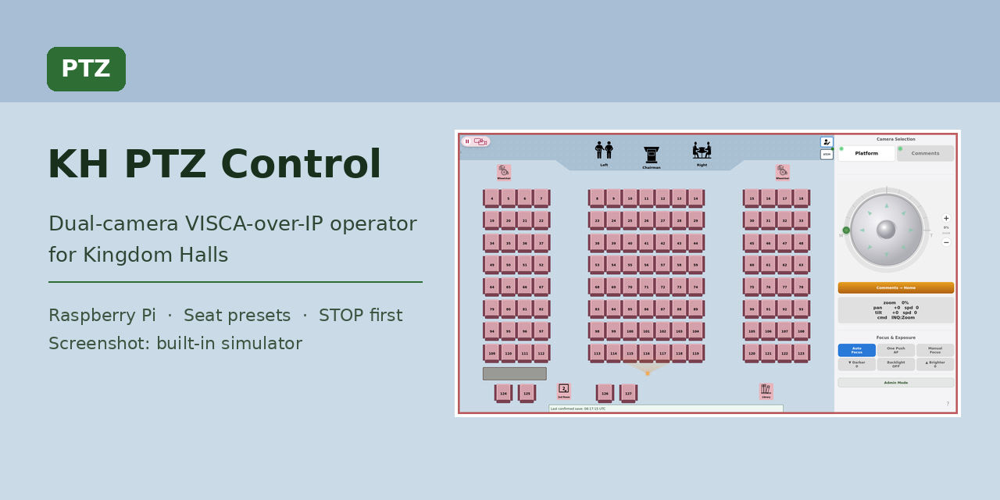
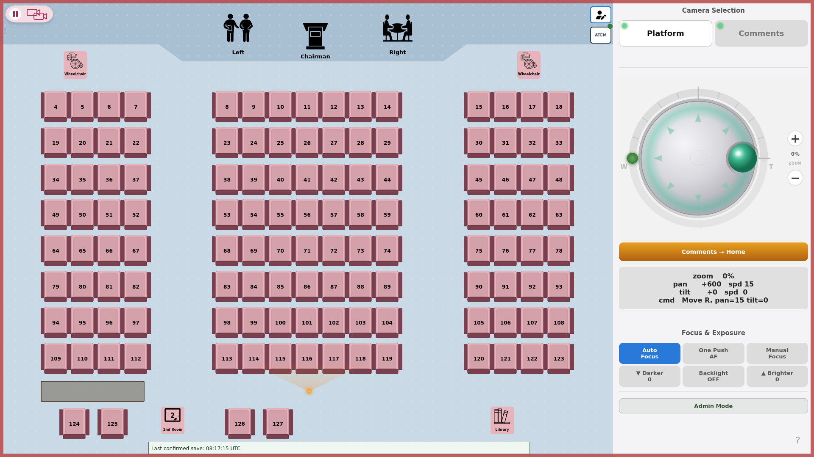
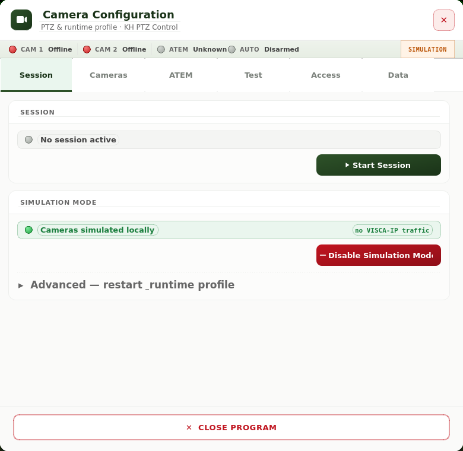

<p align="center">
  <a href="../../README.md">🇬🇧 English</a> ·
  <a href="README.es.md">🇪🇸 Español</a> ·
  <a href="README.pt.md">🇵🇹 Português</a> ·
  <a href="README.fr.md">🇫🇷 Français</a> ·
  <a href="README.de.md">🇩🇪 Deutsch</a> ·
  <a href="README.it.md">🇮🇹 Italiano</a>
</p>

<p align="center">
  
</p>


# KH PTZ Control

[Checklist di installazione in una pagina](../../QUICKSTART.md) · [Sito del progetto](https://halcondeoro.github.io/kh-ptz-control/) · [Installazione](#installazione) · [Guida dell’operatore](../OPERATOR_GUIDE.md) · [Risoluzione dei problemi delle telecamere](#risoluzione-dei-problemi-delle-telecamere)

Il sito (in inglese) segue il percorso installazione, uso e aiuto. I dettagli facoltativi su ATEM e sull’architettura sono ripiegati dopo l’aiuto. Vedi le [note su anteprima locale e pubblicazione](../PAGES.md).

Controllo touch di telecamere PTZ VISCA-over-IP su un Raspberry Pi. L’operatore tocca un posto su una mappa visiva della sala per richiamare l’inquadratura salvata, con ruoli distinti per la telecamera Platform e la telecamera Comments e comandi manuali di joystick, zoom, messa a fuoco ed esposizione.

Software libero e open source (MIT). È installato e validato sull’hardware del maintainer (Raspberry Pi e due telecamere PTZ). Gli screenshot di questo repository provengono dal simulatore integrato, non da quell’installazione. I test automatici e un’installazione riuscita non sostituiscono la verifica delle due telecamere, delle inquadrature salvate, di STOP e della ripresa sul proprio hardware. Il codice originale dell’applicazione è sotto licenza MIT. Le dipendenze dell’interfaccia e i componenti facoltativi hanno licenze proprie; vedi gli [avvisi di terze parti](../../THIRD_PARTY_NOTICES.md) e la [barriera di dipendenza ATEM](../ATEM_DEPENDENCY_DECISION.md) prima di condividere un sistema installato o di distribuire ATEM.

## Screenshot

Tutte le immagini provengono dal simulatore integrato (telecamere locali simulate), non da un’installazione fisica.

| Schermata dell’operatore | Joystick in movimento | Impostazioni |
| --- | --- | --- |
|  |  |  |

## Da dove cominciare

| Il tuo compito | Da leggere prima | Da verificare |
| --- | --- | --- |
| Installare un Raspberry Pi | [Guida all’installazione](../INSTALL_RPI.md) | Desktop e X11 pronti, controllo PASS, procedura guidata, prova fisica |
| Usare le telecamere | [Guida dell’operatore](../OPERATOR_GUIDE.md) | Telecamera e sessione scelte, CALL contro SET, STOP e soluzione fisica di riserva |
| Diagnosticare un problema | [Risoluzione dei problemi](#risoluzione-dei-problemi-delle-telecamere) | Conserva log e backup; ferma l’interfaccia prima di una diagnosi autonoma |
| Capire il codice | [Architettura](../ARCHITECTURE.md) | Presentazione, casi d’uso, dominio, adattatori e limiti di esecuzione |

## Cosa fa il progetto

- **Mappa visiva dei posti.** Tocca un posto numerato (o una posizione del palco: presidente, leggio, lettore) e la telecamera selezionata va al preset salvato per quel punto.
- **Due telecamere.** Una telecamera «Platform» e una telecamera «Comments», selezionabili sullo schermo.
- **Preset per posto.** Modalità Call per l’uso dal vivo; modalità Set per salvare o aggiornare in pochi secondi l’inquadratura di qualsiasi posto.
- **Alimentazione delle telecamere dalla schermata USER.** Un pulsante compatto pausa/play propone lo standby finché una sessione è attiva e l’accensione altrimenti, con la stessa finestra di conferma dell’avvio. Lo standby è una richiesta software, non un taglio della corrente: verifica le telecamere fisiche. STOP resta un’azione separata.
- **Comments → Home modificabile.** Un tocco richiama l’inquadratura Home salvata; tenendo premuto cinque secondi si chiede conferma e si salva l’inquadratura attuale di Comments in un preset dedicato nella memoria della telecamera. Le installazioni che non salvano mai mantengono il comportamento meccanico precedente.
- **Controllo della sessione.** Gli orari delle riunioni e i comandi di sessione espliciti separano l’uso normale dalla preparazione e dalla chiusura. Controlla lo stato della sessione sullo schermo prima di usare le telecamere.
- **Accesso dell’operatore.** Una semplice password sullo schermo protegge i controlli; un ruolo amministratore sblocca la configurazione.
- **Integrazione ATEM (facoltativa).** Lo stato delle telecamere può seguire il mixer video.
- **Modalità simulazione.** Componenti finti o dimostrativi permettono di provare l’interfaccia senza telecamere; non validano un’installazione completa su Raspberry Pi.
- **Mappa dei posti modificabile (anteprima di prova).** Un editor Qt nativo e un editor web in loopback adattano la mappa a sale con disposizione diversa. Si avviano da un lanciatore di prova esplicito, senza attivazione in produzione, senza esposizione alla LAN e senza comandi alle telecamere; vedi il [piano a tappe](../WEB_LAYOUT_EDITOR_PLAN.md).


## Sicurezza: STOP viene sempre per primo

Le telecamere si muovono; la sicurezza non è negoziabile. Il percorso dei comandi è costruito perché STOP vinca sempre:

- Un comando STOP **mette in coda insieme, con priorità, un arresto di panoramica/inclinazione e un arresto dello zoom**; l’arresto fisico dipende poi dalla telecamera e dalla rete.
- I comandi STOP passano per una **coda prioritaria** che supera qualsiasi movimento in attesa.
- Se la coda dei comandi è piena, **i nuovi comandi di movimento vengono scartati, mai uno STOP**.
- Chiudere l’app o terminare una sessione richiede l’arresto delle telecamere configurate; verifica il risultato fisico e usa la soluzione di riserva del luogo se la rete cade.

## Schermata dell’operatore

Le immagini sono state generate il 25/11/2026 con l’applicazione attuale in una simulazione locale isolata in modalità USER, con lo sfondo del repository e telecamere simulate in loopback. Mostrano il pulsante compatto di alimentazione delle telecamere di USER in alto a sinistra e il pulsante Comments → Home. Il pulsante principale STOP ALL è visibile solo in ADMIN. USER può aprire il discreto `?` sotto Admin Mode per le guide offline e STOP BOTH CAMERAS, senza conferma. L’arresto al rilascio del joystick non cambia. Non contengono nomi di persone né indirizzi di dispositivi. Gli indicatori delle telecamere vengono dal simulatore: mostrano lo stato del simulatore, non quello del sistema installato.

## Cosa non fa questo progetto

- Garantire la compatibilità con ogni modello di telecamera o mixer VISCA-over-IP.
- Dimostrare movimento, salvataggio o arresto fisico partendo solo da una spia verde o da un risultato di CI.
- Archiviare la memoria fisica dei preset della telecamera in un backup della mappa dei posti.
- Sostituire la prova dell’hardware, una soluzione fisica di riserva o la revisione della licenza ATEM.

## Requisiti

- Hardware Raspberry Pi con Raspberry Pi OS. Due obiettivi software, entrambi con validazione fisica obbligatoria sull’hardware di destinazione:
  - **Pi 4 o 5 / Bookworm (Debian 12) a 64 bit con desktop e Python 3.11**: l’obiettivo di installazione, provato in container. Bookworm parte con Wayland per impostazione predefinita e l’interfaccia richiede X11: prima di installare cambia sessione con `sudo raspi-config` -> Advanced Options -> Wayland -> X11 e riavvia. Non usare `--atem` né `--dev` su Bookworm (la PEP 668 vi blocca `pip3`).
  - **Pi 4 / Bullseye (Debian 11) a 64 bit con Python 3.9.2**: la base storica, ancora supportata. Trixie non è validato.

  Vedi [docs/INSTALL_RPI.md](../INSTALL_RPI.md) e [docs/RPI_RUNTIME_BASELINE.md](../RPI_RUNTIME_BASELINE.md).
- Uno schermo touch (l’interfaccia è pensata per il touch) e accesso di rete alle telecamere.
- Una o due telecamere PTZ VISCA-over-IP (pensato per le comuni teste AV/PTZ; non ancora validato su tutti i modelli).
- Il Python di sistema dell’obiettivo scelto (3.11 su Bookworm, 3.9.2 su Bullseye; altre versioni non sono obiettivi supportati) con PyQt5 (installato da `apt` su Raspberry Pi OS).

## Installazione

Su un sistema Raspberry Pi OS Bookworm a 64 bit appena installato, con desktop e sessione X11 (Bullseye resta la base storica; vedi [Requisiti](#requisiti)):

### 1. Scegliere la versione rivista

Esegui dal desktop del Pi con il tuo utente normale. Usa l’etichetta esatta o lo SHA completo del commit approvato per questa installazione. L’ultimo `main` non è una versione approvata.

```bash
git clone https://github.com/HALCONDEORO/kh-ptz-control.git khptz
cd khptz
read -r -p "Approved tag or full commit SHA: " APPROVED_REVISION &&
git checkout --detach "$APPROVED_REVISION" &&
git rev-parse HEAD &&
bash install_khptz_rpi.sh --guide
```

Fermati se il checkout fallisce o se lo SHA mostrato non è la versione approvata. Leggi la guida prima di continuare.

### 2. Verificare la preparazione

Tieni aperto lo stesso terminale. `--wizard-user` è il tuo utente desktop esistente, non l’account di servizio creato dall’installer.

```bash
sudo bash install_khptz_rpi.sh --wizard-user "$USER" --check
```

Se il controllo fallisce, fermati e segui il passaggio indicato. Una CI verde non è una validazione fisica del Pi.

### 3. Installare solo dopo PASS

```bash
sudo bash install_khptz_rpi.sh --wizard-user "$USER"
```

L’uscita 20 significa che manca ancora configurazione; la 30, che bisogna fermarsi e indagare sul guasto. Conserva l’output dell’installer e non incollare mai password nei report.

### 4. Completare la configurazione

L’installer crea l’utente di servizio `khptz`, le dipendenze, il servizio systemd e la sessione di avvio automatico. Segui il suo output: riavvia e accedi al desktop, oppure esegui lì `khptz setup`. La procedura guidata raccoglie i dati della sala, gli indirizzi delle telecamere e le impostazioni di accesso. Segui le istruzioni; non usare password predefinite.

La guida completa (requisiti, validazione, backup/ripristino, ritorno alla versione precedente e risoluzione dei problemi) è [docs/INSTALL_RPI.md](../INSTALL_RPI.md). Se il progetto è nuovo per te, segui la [checklist di installazione](../INSTALL_TODAY_ES.md) (in spagnolo) per il controllo dell’hardware, l’installazione e la consegna.

### Provare senza telecamere

Da una copia usa e getta del codice, esegui la nuova **prova degli adattatori solo da console**:

```bash
python3 -m simulation.rehearsal
python3 -m simulation.rehearsal --json
```

Usa gli adattatori FakeCamera in memoria per Platform e Comments, senza PyQt, indirizzi di telecamera, password né configurazione di produzione. Rifiuta le operazioni di socket nel proprio processo e prova salvataggio/richiamo, stop e standby. Non è l’interfaccia completa dell’operatore e non dimostra movimento fisico, consegna di STOP via rete, latenza dell’hardware, compatibilità delle telecamere né un’installazione su Pi. Vedi la [checklist di una pagina e i suoi limiti](../../QUICKSTART.md).

La vecchia utility `adapters/sim_mode.py on` riscrive la configurazione locale delle telecamere; è un meccanismo diverso. Non usarla su un’installazione funzionante.

## Uso delle telecamere e preset

1. Controlla la telecamera selezionata e lo stato della sessione prima di richiamare una posizione. Mantieni un solo processo di controllo connesso a ciascuna telecamera. Una seconda app, un simulatore, uno strumento di scoperta o una sonda di rete può scalzare una connessione VISCA persistente sui modelli di telecamera a sessione singola.
2. Usa **CALL** per richiamare un’inquadratura. Usa **SET** solo se vuoi sovrascrivere la posizione salvata della telecamera, con l’accesso e la conferma necessari. Prova ogni posizione salvata fuori da una riunione dal vivo, con qualcuno che osservi il risultato fisico. Vedi [CALL/SET](../CALL_SET_CONTRACT.md).
3. Considera una spia verde di connessione come informazione di trasporto. L’ammissione di un comando in coda non conferma il movimento fisico. Un timeout o un salvataggio fallito non è un successo; non premere SET ripetutamente per far cambiare la spia.
4. In modalità ADMIN, prova prima dell’uso dal vivo il pulsante rosso **STOP ALL** sotto i controlli delle telecamere e le opzioni di chiusura. La modalità USER lo nasconde; l’aiuto offline (`?` sotto Admin Mode) offre STOP BOTH CAMERAS senza conferma. Aprire l’aiuto non invia alcun comando. Entrambe le vie tentano di fermare, senza confermare l’arresto fisico; il rilascio del joystick continua a richiedere l’arresto della telecamera mossa, non di tutte. Tieni disponibile la soluzione fisica senza accesso amministratore. STOP ALL richiede l’arresto delle telecamere configurate anche senza sessione attiva; un avviso di errore significa che una telecamera potrebbe ancora muoversi. Verifica il risultato fisico. Safety Reset è un contratto di servizio, non un comando di interfaccia verificato. Leggi le [garanzie e i limiti di sicurezza](../OPERATOR_GUIDE.md). Usa la soluzione fisica del luogo invece di supporre che lo STOP software sia arrivato.

I preset VISCA sono memorizzati nella telecamera. `chairman_presets.json` associa nomi a posizioni di preset personali; `room_layout.json` salva la mappa dei posti. Un backup di questi file non copia la memoria dei preset della telecamera fisica. Se una tabella manca o è danneggiata, conserva la cartella dei dati e i backup prima di salvare nuove posizioni: riutilizzare una posizione può sovrascrivere l’inquadratura precedente di una persona.

## Integrazione ATEM facoltativa

ATEM è facoltativo. Pulsanti, pannelli e stati operativi restano nascosti finché il mixer configurato non è connesso e non è stata verificata una lettura valida del programma. Le impostazioni amministratore mantengono configurazione IP e diagnostica, così un mixer non raggiungibile può essere configurato. L’assenza di supporto ATEM deve lasciare disponibile il controllo PTZ.

La commutazione manuale e l’automazione hanno regole proprie di ruolo e sicurezza. Tieni disattivata la commutazione automatica finché non ha superato la revisione di sicurezza. PyATEMMax 1.0b9 è una base tecnica pre-release congelata, con licenza GPL, né un’approvazione alla distribuzione né una garanzia di compatibilità hardware. Rivedi la [decisione sulla dipendenza e le barriere di rilascio](../ATEM_DEPENDENCY_DECISION.md), gli [avvisi di terze parti](../../THIRD_PARTY_NOTICES.md) e la [guida di installazione ATEM](../ATEM_INSTALLATION.md) prima di qualsiasi distribuzione.

## Aggiornamento e ritorno alla versione precedente

Fallo fuori da una sessione dal vivo, con un backup recente e un’etichetta approvata o uno SHA completo. Conserva la copia originale del codice: `/opt/khptz` è una copia distribuita, non il posto dove eseguire `git pull`.

1. Annota `khptz version` e `khptz status`. Esegui `khptz backup`, verifica che sia riuscito e conserva lo ZIP fuori dal dispositivo prima di modificare qualcosa. I backup possono contenere dati privati del luogo; non allegarli a ticket pubblici.
2. Chiudi l’interfaccia in modo pulito. Ferma l’unità dell’interfaccia installata: il servizio di sistema o quello dell’utente desktop, secondo la modalità di installazione. Non avviarli entrambi.
3. Nella copia del codice, recupera e seleziona la versione approvata, poi usa lo [script di installazione](../INSTALL_RPI.md#install-the-runtime-service). Mantieni l’utente desktop e la modalità dell’interfaccia. Non aggiornare un sistema in servizio con un `main` non rivisto e non riparare i permessi con `chmod`/`chown` ricorsivi.
4. Prima di riaprire l’interfaccia, esegui `khptz verify-install`. Con l’interfaccia ferma, esegui `khptz doctor` ed esamina il risultato. Poi prova CALL, STOP e la ripresa su entrambe le telecamere. Un controllo software non certifica il funzionamento fisico.

Per un’installazione di prodotto, visualizza prima la destinazione di ritorno salvata:

```bash
sudo bash /opt/khptz/runtime/installer/rollback.sh --dry-run
```

Solo dopo aver verificato destinazione, backup e finestra di fermo:

```bash
sudo bash /opt/khptz/runtime/installer/rollback.sh
```

Il ritorno alla versione precedente ridistribuisce il codice dalla copia conservata. Non equivale a ripristinare un backup dei dati. Usa [Update and rollback](../UPDATE_ROLLBACK.md) per le destinazioni esplicite `--source` / `--to` e i dettagli sulla modalità dell’interfaccia. Non ripristinare una vecchia mappa né reimpostare la procedura guidata solo per annullare un aggiornamento del codice.

## Risoluzione dei problemi delle telecamere

Parti dal sintomo, non da un ripristino di fabbrica. Conserva lo SHA della versione, l’ora del guasto e un breve estratto di log. Rimuovi indirizzi del luogo, nomi e credenziali prima di condividere qualcosa pubblicamente.

| Sintomo | Verifiche e passo successivo |
|---|---|
| La telecamera 1 o 2 passa da connessa a disconnessa | Cerca un’altra interfaccia o un altro controller e verifica l’endpoint configurato. Ferma la sessione in sicurezza prima di aprire nuove sonde di rete. Controlla cavo, porta dello switch, alimentazione della telecamera e se la telecamera accetta un solo client TCP. Un badge verde da solo non dimostra che un comando sia terminato. |
| `Connection refused`, risposta vuota o ACK senza completamento | Rifiutata significa che la connessione è stata respinta, non che il movimento richiesto sia finito. Controlla endpoint, ascolto della telecamera e controller concorrenti. Conserva byte e orari; non ripetere riconnessioni in ciclo e non allungare i timeout alla cieca. |
| Una griglia di posti bianca o comandi che spariscono dopo aver toccato un posto | Conserva i log e annota telecamera, stato della sessione, modalità CALL/SET e azione. Cerca una traccia di eccezione Python e un cambio di stato simultaneo della telecamera. Non cancellare la mappa, non sovrascrivere i preset e non avviare Repair a caso. |
| Interfaccia assente o scura dopo l’accesso al desktop | Verifica quale servizio dell’interfaccia possiede la finestra e se la sessione desktop è X11. Vedi la [checklist dello schermo scuro](../INSTALL_RPI.md#the-gui-never-appears-after-login-dark-screen). Non avviare una seconda interfaccia per nasconderne una fallita. |
| Le modifiche a indirizzi o preset spariscono al riavvio | Verifica se l’interfaccia ha segnalato un errore di salvataggio. Conserva `config.yaml`, ogni impostazione di telecamera in esecuzione e i backup della tabella dei preset. Non rendere scrivibile `/etc/khptz` per aggirare un salvataggio fallito. |

Una risposta dal campo può contenere un ACK in IP diretto seguito da un completamento indirizzato, per esempio `9041ff` + `a051ff`, oppure `9042ff` + `a052ff`. Conserva l’intera sequenza di byte, non solo l’ACK. Questi esempi non significano che due frame qualsiasi dimostrino il successo: contano anche indirizzo, socket di comando, errore terminale e timeout superato. Vedi [camera command results](../CAMERA_COMMAND_RESULTS.md).

`khptz verify-install` controlla lo stato dell’installazione senza accesso all’hardware. Invece non eseguire `khptz cameras` né `khptz doctor` accanto a un’interfaccia in servizio: queste diagnosi autonome possono aprire connessioni aggiuntive verso le telecamere. Ferma prima l’interfaccia e pianifica una finestra di prova sicura. Un pacchetto di supporto viene ripulito, ma rivedilo prima di condividerlo; vedi l’[ambito del pacchetto di supporto](../SUPPORT_BUNDLE_CONTRACT.md).

Per le installazioni in cui l’interfaccia è un servizio di sistema:

```bash
khptz version
khptz status
sudo systemctl status khptz-control.service --no-pager
journalctl -u khptz-control.service -n 100 --no-pager
```

Per un’interfaccia di proprietà della sessione, esegui questo con il suo utente desktop:

```bash
systemctl --user status khptz-gui.service --no-pager
journalctl --user -u khptz-gui.service -n 100 --no-pager
```

Non pubblicare log grezzi senza verificare che non contengano informazioni private. Per l’elenco più lungo, parti dalla [risoluzione dei problemi di installazione](../INSTALL_RPI.md).

## Mappa del repository

Tieni il codice dell’applicazione separato dalla configurazione e dai dati salvati del luogo:

| Percorso | Responsabilità |
|---|---|
| `main.py`, `bootstrap.py` | Punto di ingresso e cablaggio delle dipendenze |
| `domain/`, `application/` | Modelli, validazione e casi d’uso |
| `ports/`, `adapters/` | Interfacce e relative implementazioni hardware e di archiviazione |
| `ptz/visca/` | Frame, analisi, worker e proprietà della connessione VISCA |
| `core/` | Gestione degli eventi, stato di esecuzione e supervisione |
| `ui/` | Finestre PyQt, controlli e resa della mappa |
| `runtime/`, `install_khptz_rpi.sh` | CLI, distribuzione, systemd e controlli di installazione |
| `config/` | Schema di configurazione e modelli forniti, non i dati reali del luogo |
| `simulation/`, `tests/` | Hardware simulato e test di regressione |
| `docs/` | Guide di esercizio, installazione, supporto e sviluppo |

Le installazioni di prodotto tengono la configurazione in `/etc/khptz`, i dati di esecuzione in `/var/lib/khptz`, i log in `/var/log/khptz` e i backup in `/var/backups/khptz`. Non spostarli nella copia del codice. Vedi l’[indice della documentazione](../DOCS_INDEX.md), l’[architettura](../ARCHITECTURE.md) e il [contratto dei percorsi di esecuzione](../RUNTIME_PATH_CONTRACT.md) prima di riorganizzare il codice.

## Stato

Installato e validato dal maintainer; lo sviluppo continua. Ferma l’interfaccia prima di qualsiasi diagnosi autonoma delle telecamere; non avviare un secondo controller su telecamere in servizio. Prova in sicurezza, valida l’hardware fisico e registra i risultati in `docs/MVP_VALIDATION_REPORT.md`. La simulazione non è validazione fisica. Vedi [docs/ROADMAP.md](../ROADMAP.md) per i prossimi passi.

## Contribuire

Ticket e pull request sono benvenuti. Leggi prima [AGENTS.md](../../AGENTS.md) e [docs/DOCS_INDEX.md](../DOCS_INDEX.md) e mantieni verdi i confini dell’architettura a strati (`pytest tests/architecture`).

## Licenza

Codice originale: MIT, vedi [LICENSE](../../LICENSE). Le dipendenze installate mantengono le proprie condizioni; vedi [THIRD_PARTY_NOTICES.md](../../THIRD_PARTY_NOTICES.md).
