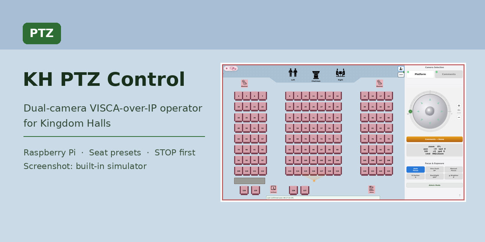
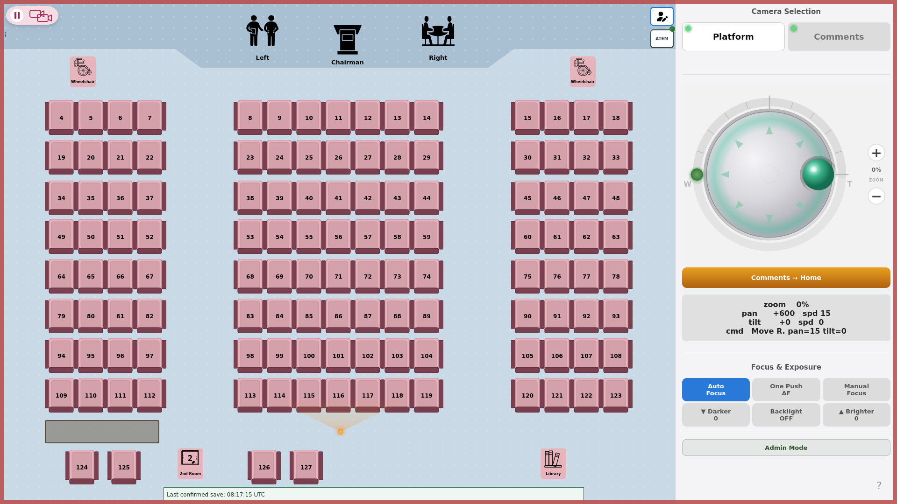
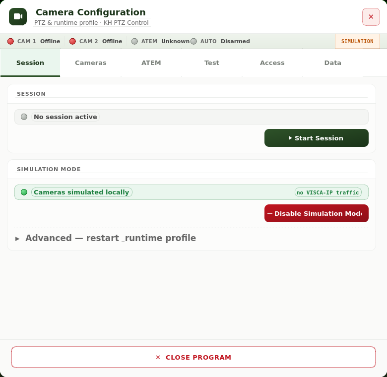

<p align="center">
  <a href="../../README.md">🇬🇧 English</a> ·
  <a href="README.es.md">🇪🇸 Español</a> ·
  <a href="README.pt.md">🇵🇹 Português</a> ·
  <a href="README.fr.md">🇫🇷 Français</a> ·
  <a href="README.de.md">🇩🇪 Deutsch</a> ·
  <a href="README.it.md">🇮🇹 Italiano</a>
</p>

<p align="center">
  
</p>


# KH PTZ Control

[Lista de instalação de uma página](../../QUICKSTART.md) · [Site do projeto](https://halcondeoro.github.io/kh-ptz-control/) · [Instalação](#instalação) · [Guia do operador](../OPERATOR_GUIDE.md) · [Resolução de problemas](#resolução-de-problemas-das-câmaras)

O site (em inglês) segue o caminho de instalação, utilização e ajuda. Os detalhes opcionais de ATEM e de arquitetura ficam recolhidos depois da ajuda. Consulte as [notas de pré-visualização local e publicação](../PAGES.md).

Controlo tátil de câmaras PTZ VISCA-over-IP num Raspberry Pi. O operador toca num lugar numa planta visual do auditório para chamar o enquadramento guardado, com funções separadas para a câmara Platform e a câmara Comments e controlos manuais de joystick, zoom, foco e exposição.

Livre e de código aberto (MIT). Está instalado e validado no equipamento do próprio responsável (Raspberry Pi e duas câmaras PTZ). As capturas deste repositório vêm do simulador integrado, não dessa instalação. Os testes automáticos e uma instalação bem-sucedida não substituem a validação das duas câmaras, dos enquadramentos guardados, do STOP e da recuperação no seu próprio equipamento. O código original da aplicação tem licença MIT. As dependências da interface e os componentes opcionais têm licenças próprias; consulte os [avisos de terceiros](../../THIRD_PARTY_NOTICES.md) e a [barreira de dependência do ATEM](../ATEM_DEPENDENCY_DECISION.md) antes de partilhar um sistema instalado ou de implementar ATEM.

## Capturas de ecrã

Todas as imagens vêm do simulador integrado (câmaras locais simuladas), não de uma instalação física.

| Ecrã do operador | Joystick em movimento | Definições |
| --- | --- | --- |
|  |  |  |

## Comece aqui

| A sua tarefa | Leia primeiro | O que verificar |
| --- | --- | --- |
| Instalar um Raspberry Pi | [Guia de instalação](../INSTALL_RPI.md) | Ambiente de trabalho e X11 prontos, verificação PASS, assistente, ensaio físico |
| Operar as câmaras | [Guia do operador](../OPERATOR_GUIDE.md) | Câmara e sessão selecionadas, CALL contra SET, STOP e alternativa física |
| Diagnosticar um problema | [Resolução de problemas](#resolução-de-problemas-das-câmaras) | Guarde registos e cópias; pare a GUI antes de diagnósticos independentes |
| Perceber o código | [Arquitetura](../ARCHITECTURE.md) | Apresentação, casos de uso, domínio, adaptadores e limites de execução |

## O que faz

- **Planta visual de lugares.** Toque num lugar numerado (ou numa posição da plataforma: presidente, púlpito, leitor) e a câmara selecionada vai para o preset guardado desse lugar.
- **Duas câmaras.** Uma câmara "Platform" e uma câmara "Comments", escolhidas no ecrã.
- **Presets por lugar.** Modo Call para operar em direto; modo Set para guardar ou atualizar o enquadramento de qualquer lugar em segundos.
- **Energia das câmaras no ecrã USER.** Um botão compacto de pausa/play oferece standby enquanto há sessão ativa e ligar quando não há, com o mesmo diálogo de confirmação do arranque. Standby é um pedido por software, não um corte de energia: confirme as câmaras físicas. O STOP continua a ser uma ação separada.
- **Comments → Home editável.** Um toque chama o enquadramento Home guardado; manter o botão cinco segundos pede confirmação e guarda o enquadramento atual de Comments num preset próprio na memória da câmara. Instalações que nunca guardam um mantêm o comportamento mecânico anterior.
- **Controlo de sessão.** Os horários de reunião e os controlos explícitos de sessão separam a operação normal da preparação e do encerramento. Verifique o estado da sessão no ecrã antes de usar as câmaras.
- **Início de sessão do operador.** Uma palavra-passe simples no ecrã protege os controlos; uma função de administrador desbloqueia a configuração.
- **Integração ATEM (opcional).** O estado das câmaras pode acompanhar o misturador de vídeo.
- **Modo de simulação.** Componentes falsos ou de demonstração permitem ensaiar a interface sem câmaras; não validam uma instalação completa em Raspberry Pi.
- **Planta de lugares editável (pré-visualização de testes).** Um editor Qt nativo e um editor web em loopback adaptam a planta a salas com outra disposição. Correm a partir de um lançador de testes explícito, sem ativação em produção, sem exposição à rede local e sem comandos às câmaras; veja o [plano por fases](../WEB_LAYOUT_EDITOR_PLAN.md).


## Segurança: o STOP é sempre o primeiro

As câmaras movem-se; a segurança não é negociável. O caminho de controlo foi construído para que o STOP ganhe sempre:

- Um comando STOP **põe em fila uma paragem de rotação/inclinação e uma paragem de zoom em conjunto, com prioridade**; a paragem física depende da câmara e da rede.
- Os comandos STOP seguem por uma **fila de prioridade** que ultrapassa qualquer movimento pendente.
- Se a fila de comandos estiver cheia, **são descartados os novos comandos de movimento, nunca um STOP**.
- Fechar a aplicação ou terminar uma sessão pede a paragem das câmaras configuradas; confirme o resultado físico e use a alternativa do local se a rede falhar.

## Ecrã do operador

As capturas foram geradas com a aplicação atual numa simulação local isolada em modo USER a 25/11/2026, com o fundo do repositório e câmaras simuladas em loopback. Mostram o botão compacto de energia das câmaras do USER no canto superior esquerdo e o botão Comments → Home. O botão principal STOP ALL só é visível em ADMIN. O USER pode abrir o discreto `?` por baixo de Admin Mode para guias offline e STOP BOTH CAMERAS, sem confirmação. A paragem ao largar o joystick não muda. Não contêm nomes pessoais nem endereços de dispositivos. Os indicadores das câmaras vêm do simulador, por isso mostram o estado do simulador, não o do sistema instalado.

## O que este projeto não faz

- Garantir compatibilidade com todos os modelos de câmara ou misturador VISCA-over-IP.
- Provar movimento, gravação ou paragem física a partir de um indicador verde ou de um resultado de CI.
- Guardar a memória física de presets da câmara dentro de uma cópia da planta de lugares.
- Substituir o ensaio do equipamento, uma alternativa física ou a revisão da licença do ATEM.

## Requisitos

- Hardware Raspberry Pi com Raspberry Pi OS. Dois alvos de software, ambos com validação física obrigatória no equipamento de destino:
  - **Pi 4 ou 5 / Bookworm (Debian 12) de 64 bits com ambiente de trabalho e Python 3.11**: o alvo de instalação, ensaiado em contentor. O Bookworm arranca em Wayland por defeito e a interface precisa de X11: mude a sessão com `sudo raspi-config` -> Advanced Options -> Wayland -> X11 e reinicie antes de instalar. Não use `--atem` nem `--dev` no Bookworm (a PEP 668 bloqueia o `pip3`).
  - **Pi 4 / Bullseye (Debian 11) de 64 bits com Python 3.9.2**: a base antiga, ainda suportada. O Trixie não está validado.

  Veja [docs/INSTALL_RPI.md](../INSTALL_RPI.md) e [docs/RPI_RUNTIME_BASELINE.md](../RPI_RUNTIME_BASELINE.md).
- Um ecrã tátil (a interface foi pensada para toque) e acesso de rede às câmaras.
- Uma ou duas câmaras PTZ VISCA-over-IP (pensado para cabeças AV/PTZ comuns; ainda não validado em todos os modelos).
- O Python do sistema do alvo escolhido (3.11 no Bookworm, 3.9.2 no Bullseye; outras versões não são alvos suportados) com PyQt5 (instalado a partir do `apt` no Raspberry Pi OS).

## Instalação

Num sistema Raspberry Pi OS Bookworm de 64 bits com ambiente de trabalho e sessão X11 acabado de instalar (o Bullseye continua como base antiga; veja [Requisitos](#requisitos)):

### 1. Escolha a versão revista

Execute a partir do ambiente de trabalho do Pi com o seu utilizador normal. Use a etiqueta exata ou o SHA completo do commit aprovado para esta instalação. A `main` mais recente não é uma versão aprovada.

```bash
git clone https://github.com/HALCONDEORO/kh-ptz-control.git khptz
cd khptz
read -r -p "Approved tag or full commit SHA: " APPROVED_REVISION &&
git checkout --detach "$APPROVED_REVISION" &&
git rev-parse HEAD &&
bash install_khptz_rpi.sh --guide
```

Pare se o checkout falhar ou se o SHA mostrado não for a versão aprovada. Leia o guia antes de continuar.

### 2. Verifique a preparação

Mantenha o mesmo terminal aberto. `--wizard-user` indica o seu utilizador de ambiente de trabalho existente, não a conta de serviço criada pelo instalador.

```bash
sudo bash install_khptz_rpi.sh --wizard-user "$USER" --check
```

Se a verificação falhar, pare e siga o passo seguinte indicado. Uma CI a passar não é validação física do Pi.

### 3. Instale só depois de PASS

```bash
sudo bash install_khptz_rpi.sh --wizard-user "$USER"
```

A saída 20 significa que ainda falta configuração; a 30, que deve parar e inspecionar a falha. Guarde a saída do instalador e nunca cole palavras-passe em relatórios.

### 4. Conclua a configuração

O instalador cria o utilizador de serviço `khptz`, as dependências, o serviço systemd e a sessão de arranque automático. Siga a sua saída: reinicie e inicie sessão no ambiente de trabalho, ou execute aí `khptz setup`. O assistente recolhe os dados da sala, os endereços das câmaras e as definições de acesso. Siga as indicações; não use uma palavra-passe predefinida.

O guia completo (pré-requisitos, validação, cópia e restauro, reversão e resolução de problemas) é [docs/INSTALL_RPI.md](../INSTALL_RPI.md). Se é novo no projeto, siga a [lista de instalação](../INSTALL_TODAY_ES.md) (em espanhol) para a verificação do equipamento, a instalação e a entrega.

### Experimentar sem câmaras

A partir de uma cópia de código descartável, execute o novo **ensaio de adaptadores só em consola**:

```bash
python3 -m simulation.rehearsal
python3 -m simulation.rehearsal --json
```

Usa os adaptadores FakeCamera em memória para Platform e Comments, sem PyQt, endereços de câmara, palavras-passe nem configuração de produção. Nega operações de socket no seu processo e exercita guardar/chamar, stop e standby. Não é a GUI completa do operador e não prova movimento físico, entrega do STOP pela rede, latência do hardware, compatibilidade de câmaras nem uma instalação no Pi. Veja a [lista de uma página e os seus limites](../../QUICKSTART.md).

O antigo auxiliar `adapters/sim_mode.py on` reescreve a configuração local das câmaras; é um mecanismo diferente. Não o use numa instalação que funciona.

## Operação das câmaras e presets

1. Verifique a câmara selecionada e o estado da sessão antes de chamar uma posição. Mantenha um só processo controlador ligado a cada câmara. Uma segunda aplicação, simulador, ferramenta de descoberta ou sonda de rede pode deslocar uma ligação VISCA persistente em modelos de câmara de sessão única.
2. Use **CALL** para chamar um enquadramento. Use **SET** só quando quiser substituir a posição guardada da câmara, com o acesso e a confirmação necessários. Teste cada posição guardada fora de uma reunião em direto, com alguém a ver o resultado físico. Veja [CALL/SET](../CALL_SET_CONTRACT.md).
3. Trate um indicador verde de ligação como informação de transporte. A entrada do comando na fila não confirma movimento físico. Um tempo esgotado ou uma gravação falhada não é sucesso; não prima SET repetidamente para mudar o indicador.
4. Em modo ADMIN, ensaie o botão vermelho **STOP ALL** por baixo dos controlos da câmara e as opções de fecho antes do uso em direto. O modo USER esconde este botão; a ajuda offline (`?` por baixo de Admin Mode) oferece STOP BOTH CAMERAS sem confirmação. Abrir a ajuda não envia comandos. Ambos os caminhos tentam parar, não confirmam a paragem física; largar o joystick continua a pedir a paragem da câmara movida, não de todas. Mantenha disponível a alternativa física sem acesso de administrador. STOP ALL pede a paragem das câmaras configuradas mesmo sem sessão ativa; um aviso de falha significa que uma câmara ainda pode estar em movimento. Confirme o resultado físico. Safety Reset é um contrato de serviço, não um controlo da GUI verificado. Leia as [garantias e limites de segurança](../OPERATOR_GUIDE.md). Use a alternativa física do local em vez de assumir que o STOP por software chegou.

Os presets VISCA são guardados na memória da câmara. `chairman_presets.json` associa nomes a ranhuras de preset pessoais; `room_layout.json` guarda a planta de lugares. Uma cópia destes ficheiros não copia a memória de presets da câmara física. Se faltar um mapa ou estiver corrompido, preserve o diretório de dados e as cópias antes de guardar novas posições: reutilizar uma ranhura pode substituir o enquadramento anterior de uma pessoa.

## Integração ATEM opcional

O ATEM é opcional. Os botões, painéis e estados operacionais ficam escondidos até o misturador configurado estar ligado e ter sido verificada uma leitura de programa válida. As definições de administrador mantêm a configuração de IP e os diagnósticos para que um misturador indisponível possa ser configurado. Sem suporte ATEM, o controlo PTZ tem de continuar disponível.

A comutação manual e a automática têm as suas próprias regras de função e segurança. Mantenha a comutação automática desativada até passar a sua revisão de segurança. O PyATEMMax 1.0b9 é uma base técnica pré-lançamento fixada, com termos de licença GPL, não uma aprovação de distribuição nem uma garantia de compatibilidade de hardware. Reveja a [decisão de dependência e as barreiras de versão](../ATEM_DEPENDENCY_DECISION.md), os [avisos de terceiros](../../THIRD_PARTY_NOTICES.md) e o [guia de instalação do ATEM](../ATEM_INSTALLATION.md) antes de implementar.

## Atualização e reversão

Faça-o fora de uma sessão em direto, com uma cópia de segurança atual e uma etiqueta aprovada ou um SHA completo. Mantenha a cópia de código original: `/opt/khptz` é uma cópia implementada, não o sítio para executar `git pull`.

1. Registe `khptz version` e `khptz status`. Execute `khptz backup`, confirme que correu bem e guarde o ZIP resultante fora do dispositivo antes de o alterar. As cópias podem conter dados privados do local; não as anexe a issues públicas.
2. Feche a GUI de forma limpa. Pare a unidade GUI instalada: o serviço do sistema ou o do utilizador do ambiente de trabalho, conforme o modo de instalação. Não arranque ambas.
3. Na cópia de código, obtenha e selecione a versão aprovada e use o [script de instalação](../INSTALL_RPI.md#install-the-runtime-service). Preserve o utilizador do ambiente de trabalho e o modo da GUI. Não atualize um sistema em uso com uma `main` por rever nem repare permissões com `chmod`/`chown` recursivos.
4. Antes de reabrir a GUI, execute `khptz verify-install`. Com a GUI parada, execute `khptz doctor` e analise o resultado. Depois ensaie CALL, STOP e recuperação nas duas câmaras. Uma verificação por software não certifica o funcionamento físico.

Numa instalação de produto, pré-visualize primeiro o destino de reversão registado:

```bash
sudo bash /opt/khptz/runtime/installer/rollback.sh --dry-run
```

Só depois de verificar o destino, a cópia e a janela de paragem:

```bash
sudo bash /opt/khptz/runtime/installer/rollback.sh
```

A reversão volta a implementar o código a partir da cópia de código mantida. Não é o mesmo que restaurar uma cópia de dados. Use [Update and rollback](../UPDATE_ROLLBACK.md) para destinos explícitos `--source` / `--to` e detalhes do modo da GUI. Não restaure uma planta antiga nem reponha o assistente apenas para desfazer uma atualização de código.

## Resolução de problemas das câmaras

Comece pelo sintoma, não por uma reposição de fábrica. Guarde o SHA da versão, a hora da falha e um excerto curto do registo. Retire endereços do local, nomes e credenciais antes de partilhar o que quer que seja publicamente.

| Sintoma | Verificações e passo seguinte |
|---|---|
| A câmara 1 ou 2 alterna entre ligada e desligada | Verifique se há outra GUI ou controlador e confirme o endpoint configurado. Pare a sessão com segurança antes de abrir novas sondas de rede. Verifique cabo, porta do switch, alimentação da câmara e se a câmara aceita apenas um cliente TCP. Um indicador verde, por si só, não prova que um comando terminou. |
| `Connection refused`, resposta vazia ou ACK sem conclusão | Recusada significa que a ligação foi rejeitada, não que o movimento pedido terminou. Verifique o endpoint, o serviço da câmara e controladores concorrentes. Guarde os bytes e as marcas de tempo; não repita ligações nem aumente tempos limite às cegas. |
| Uma grelha de lugares branca ou controlos que desaparecem ao tocar num lugar | Preserve os registos e anote câmara, estado da sessão, modo CALL/SET e ação. Procure um traceback do Python e uma mudança simultânea do estado da câmara. Não apague a planta, não substitua presets nem execute Repair por palpite. |
| GUI em falta ou escura após iniciar sessão no ambiente de trabalho | Verifique que serviço GUI é dono da janela e se a sessão é X11. Veja a [lista do ecrã escuro](../INSTALL_RPI.md#the-gui-never-appears-after-login-dark-screen). Não arranque uma segunda GUI para tapar uma que falhou. |
| As alterações de endereço ou presets desaparecem após reiniciar | Verifique se a interface avisou de uma falha ao guardar. Preserve `config.yaml`, qualquer ajuste de câmara em execução e as cópias do mapa de presets. Não torne `/etc/khptz` gravável para contornar uma gravação falhada. |

Uma resposta de campo pode trazer um ACK de IP direto seguido de uma conclusão endereçada, por exemplo `9041ff` + `a051ff`, ou `9042ff` + `a052ff`. Guarde a sequência completa de bytes, não só o ACK. Estes exemplos não são uma regra de que duas tramas quaisquer provam sucesso: o endereço, o socket de comandos, o erro terminal e o tempo esgotado também contam. Veja [camera command results](../CAMERA_COMMAND_RESULTS.md).

`khptz verify-install` verifica o estado da instalação sem aceder ao hardware. Em contrapartida, não execute `khptz cameras` nem `khptz doctor` junto a uma GUI em uso: estes diagnósticos independentes podem abrir ligações adicionais às câmaras. Pare primeiro a GUI e combine uma janela de teste segura. Um pacote de suporte é higienizado, mas reveja-o antes de o partilhar; veja o [âmbito do pacote de suporte](../SUPPORT_BUNDLE_CONTRACT.md).

Para instalações com a GUI como serviço do sistema:

```bash
khptz version
khptz status
sudo systemctl status khptz-control.service --no-pager
journalctl -u khptz-control.service -n 100 --no-pager
```

Para uma GUI da própria sessão, execute isto como o seu utilizador do ambiente de trabalho:

```bash
systemctl --user status khptz-gui.service --no-pager
journalctl --user -u khptz-gui.service -n 100 --no-pager
```

Não publique registos em bruto sem verificar se contêm informação privada. Para a lista mais longa, comece na [resolução de problemas da instalação](../INSTALL_RPI.md).

## Mapa do repositório

Mantenha o código da aplicação separado da configuração e dos dados do local:

| Caminho | Responsabilidade |
|---|---|
| `main.py`, `bootstrap.py` | Ponto de entrada e ligação de dependências |
| `domain/`, `application/` | Modelos, validação e casos de uso |
| `ports/`, `adapters/` | Interfaces e as suas implementações de hardware e armazenamento |
| `ptz/visca/` | Tramas, análise, workers e propriedade da ligação VISCA |
| `core/` | Tratamento de eventos, estado de execução e supervisão |
| `ui/` | Janelas PyQt, controlos e desenho da planta |
| `runtime/`, `install_khptz_rpi.sh` | CLI, implementação, systemd e verificações de instalação |
| `config/` | Esquema de configuração e modelos incluídos, não dados reais do local |
| `simulation/`, `tests/` | Equipamento simulado e testes de regressão |
| `docs/` | Guias de operador, instalação, suporte e desenvolvimento |

As instalações de produto guardam a configuração em `/etc/khptz`, os dados de execução em `/var/lib/khptz`, os registos em `/var/log/khptz` e as cópias em `/var/backups/khptz`. Não os mova para a cópia de código. Veja o [índice de documentação](../DOCS_INDEX.md), a [arquitetura](../ARCHITECTURE.md) e o [contrato de caminhos de execução](../RUNTIME_PATH_CONTRACT.md) antes de reorganizar código.

## Estado

Instalado e validado pelo responsável; o desenvolvimento continua. Pare a GUI antes de diagnósticos de câmara independentes; não execute um segundo controlador contra câmaras em uso. Ensaie com segurança, valide o equipamento físico e registe os resultados em `docs/MVP_VALIDATION_REPORT.md`. A simulação não é validação física. Veja [docs/ROADMAP.md](../ROADMAP.md) para o que vem a seguir.

## Contribuir

Issues e pull requests são bem-vindos. Leia primeiro [AGENTS.md](../../AGENTS.md) e [docs/DOCS_INDEX.md](../DOCS_INDEX.md) e mantenha verdes os limites da arquitetura em camadas (`pytest tests/architecture`).

## Licença

Código original: MIT, veja [LICENSE](../../LICENSE). As dependências instaladas mantêm os seus próprios termos; veja [THIRD_PARTY_NOTICES.md](../../THIRD_PARTY_NOTICES.md).
